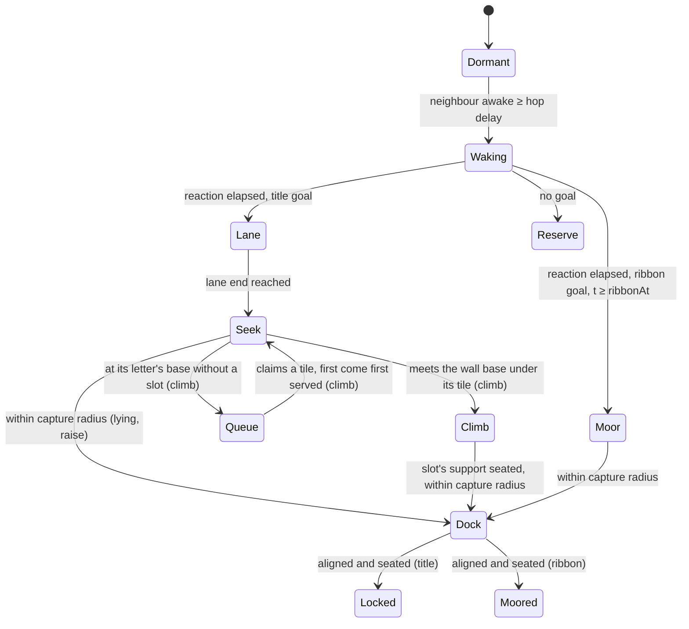

# Nanite swarm behaviour: intro first, gameplay next

Proposal and prototype, 2026-10-12. Extends the [director's brief](director-brief.md) and
[experience design](experience-design.md). The S0 to S0d prototypes are
[spikes/swarm_intro](../../../spikes/swarm_intro/README.md).

User direction, the same day:
- The final CRUCIBLE title **stands upright**; ground-based assembly is acceptable for early
  milestones.
- Units decide their slot at the base, in arrival order, with no preset order.
- They work through conflicts by queueing, waiting and selective magnetism.
- The sequence may run to **15 s**.
- Tiles interlock into a solid join.
- Behaviour is recorded through Sub0Log's JSONL diagnostics.

Sections 5 and 6 cover these. Nothing here changes gameplay
rules, the biomass ledger or Phase14 gates. Every later stage is a reviewable proposal and
is not dispatched by this document.

## 1. Gap: the intro's swarm behaviour was undefined

The Phase15 plan and brief define what the intro must **look like** and **when**: six
timed shots, wedge material and light, title-mask readability, skip and reduced-motion
policy, fidelity tiers (at most 4096 live instances balanced, 16384 cinematic) and the rule
that decorative intro nanites are view-owned and never impersonate the gameplay population.
Package P15-E0 owns "deterministic twelve-second wordmark choreography".

They do not define **how the nanites behave**. Before this proposal nothing specified:

- how the answer wave travels (which unit wakes whom, at what rate);
- which nanite goes to which slot, and in which order, so streams do not cross or block;
- how lanes form and how units leave them for strokes;
- how units avoid passing through one another, and where that is allowed to be cheap;
- how per-unit intelligence is shown, and which units pay for it;
- how docking, locking, surplus units and the ribbon work;
- how decision level of detail (LOD) relates to the camera, and why it cannot change the outcome;
- which ECS components, systems, ordering and structural-change points implement it;
- how this architecture extends into gameplay without breaking determinism or replay.

This document closes that gap for the intro and proposes the path to gameplay. It is
recorded as finding P15-F10 in the [Phase15 review](../../sprint-reviews/phase-15.md).

## 2. Prior art

| Work | What it contributes here |
|---|---|
| Disney Animation, *Big Hero 6* microbots: "Procedural Animation Technology behind Microbots in Big Hero 6" (Byun, Falt, Frost, Ali, Daniels, De Mund, Kaschalk; SIGGRAPH 2015 talk) | Tens of millions of small robots joined by electromagnetism, rearranging by sliding over one another. Disney's answer to directing them precisely was custom procedural animation algorithms. We adopt the same split: authored intent, procedural local rules. We also borrow their sliding: moving units glide over resting ones instead of colliding with them. |
| Rubenstein, Cornejo, Nagpal, "Programmable self-assembly in a thousand-robot swarm", *Science* 345 (2014) | 1024 Kilobots formed shapes from purely local rules, starting from a few seed robots: a hop-count gradient, local localisation and edge-following. Our answer wave is that gradient, and the first wedge is the seed. Their shapes took hours, a reminder that cinema compresses time by planning centrally. |
| Turpin, Michael, Kumar, "CAPT: Concurrent assignment and planning of trajectories for multiple robots", *IJRR* 33 (2014) | For interchangeable robots, assigning goals to minimise summed squared distance makes synchronised straight-line paths collision-free. The decentralised variant, d-CAPT, has neighbours exchange goals locally. We pair a central plan at load with local d-CAPT swaps. |
| Reynolds, "Flocks, herds and schools" (SIGGRAPH 1987) | Separation, alignment and cohesion: the near tier's reactive layer. |
| van den Berg, Lin, Manocha, reciprocal velocity obstacles (2008), and ORCA (2011) | Choosing a velocity from predicted time-to-collision gives visible anticipation and yielding. The hero tier samples velocity obstacles. |
| Treuille, Cooper, Popović, "Continuum crowds" (SIGGRAPH 2006) | Density and flow fields replace pairwise interaction for large crowds. The far tier uses a per-cell density gradient. |
| Müller et al., "Position based dynamics" (2007) | Iterative projection keeps a non-penetration constraint stable at fixed cost. |
| O'Sullivan et al., "Levels of detail for crowds and groups" (*Computer Graphics Forum*, 2002); Massive (Weta) crowd brains | Behaviour detail can be spent where the viewer looks. Massive gave each crowd agent its own fuzzy-logic brain. |
| Trautman, Krause, the "freezing robot problem" (IROS 2010) | Agents that are too cautious in dense crowds stall. The S0 prototype reproduced this; see findings. |
| Romanishin, Gilpin, Rus, M-Blocks (IROS 2013); Goldstein, Mowry, Claytronics (CMU); Werfel, Petersen, Nagpal, TERMES (*Science* 2014) | Modular self-assembly by pivoting or climbing over neighbours, programmable matter, and stigmergic construction. These are the vocabulary for later gameplay forms (section 10). |
| Drone light shows (Intel Shooting Star and successors) | Offline-planned assignment and trajectories for hundreds of real units forming logos: the production precedent for a central plan with live execution. |

The Big Hero 6 and Kilobot facts were checked against the
[SIGGRAPH history record](https://history.siggraph.org/learning/procedural-animation-technology-behind-microbots-in-big-hero-6)
and the [Harvard SEAS release](https://seas.harvard.edu/news/self-organizing-thousand-robot-swarm).
Other citations are from the author's knowledge. Verify them before any external publication.

## 3. Principles

1. **Intelligence is legibility of intent, not compute.** A nanite looks intelligent when
   its intent can be read: it turns toward its goal before moving (anticipation), yields
   or sidesteps visibly, trades places with a neighbour, and docks with a deliberate
   rotate-then-slide. Every unit runs the same rules. LOD decides how much of that mind is
   evaluated per tick, not who the unit is.
2. **Spend the decision budget where the camera looks.** Decision LOD is separate from
   render LOD. A hero unit makes full per-unit choices; a far unit follows a field. Hidden
   units move analytically.
3. **Every tier guarantees something.** Visible movers never pass through one another.
   Hidden units may, and must be resolved before they can be seen. Every tier reaches the
   same final arrangement.
4. **Plan centrally, act locally.** Assignment, lanes and timing are authored at load;
   the live behaviour is local and reactive. This gives art direction and timing guarantees
   with emergent texture, as in *Big Hero 6* and drone shows.
5. **Deterministic and view-owned.** Fixed tick, seeded personality, a frozen gather each
   tick and identity-ordered serial passes. The intro owns its own ECS world. The camera
   is scripted, so camera-driven LOD stays reproducible.
6. **Structural change at tick boundaries only.** Tier migration happens after all systems
   finish, with hysteresis, so partition churn is bounded.

## 4. Intro architecture (S0, implemented)

### Components and partitions

`Identity{index, seed}`, `Pose{x, y, z, heading}`, `Motion{vx, vy}`,
`Mind{act, lane, goal, ribbon, actSince, laneS, laneOffset, speedScale, reaction}`, and
exactly one tier tag. Queries are declared per tier, so Sub0ECS keeps a partition per
tier, and a tier system costs time proportional to that tier's population.

### Ordered tick (60 Hz fixed)

| # | System | Reads | Writes | Notes |
|---|---|---|---|---|
| 0 | Camera | timeline | camera | Scripted lens path: macro, pullback, rise, hold, open |
| 1 | Gather | ECS | frozen arrays, grid | The tick-start epoch every later system reads |
| 2 | Signal | gather | own `Mind`, wake time | The answer wave; order-independent |
| 3 | Behaviour ×4 | gather | own `Pose`/`Motion`/`Mind` | One system per tier partition (Jacobi, parallel-safe per row) |
| 4 | Negotiation | gather | `Mind.goal` pairs | Serial identity-ordered d-CAPT swaps; the only cross-row write |
| 5 | Resolve | post-behaviour poses | visible movers' poses | Projection with a fixed number of passes |
| 6 | LOD | poses, camera | tier tags (structural) | After all systems; hysteresis; hero cap |
| 7 | Metrics | ECS | diagnostics | Advisory; excluded from tick cost |

Rows 2 to 5 are where Sub0Pipeline row-range parallelism can be applied later. Each writes
only its own row, except the serial negotiation pass.

### Act state machine

The rest layer is Dormant, Dock, Locked, Moored and Reserve. Movers glide over it with a
cosmetic climb height `z`, which the renderer lifts and shades. In the climb build,
climbers also flow over each other in layers rather than colliding (section 5).

### Decision tiers

| Tier | Who | Behaviour | Guarantee | Cost driver |
|---|---|---|---|---|
| Hero | At most `heroCap` (128) movers nearest the focus, at ≥10 px per unit | Sampled velocity obstacles against senior neighbours; anticipation; climb; nuanced turns; docking ritual | No visible pass-through; intent readable | Candidates × neighbours |
| Near | Visible, ≥6 px per unit, inner 80% of frame | Desired velocity plus separation; climb | No visible pass-through (with resolve) | Neighbour query |
| Far | Visible, outer frame or sub-6 px | Density-gradient push, O(1) | Resolve keeps contacts glancing | One cell lookup |
| Hidden | Outside view plus margin | Analytic goal motion | Same goal and timing; resolved on entry | None |

Render LOD (mesh detail, core glow, shadow) is chosen independently from pixels per unit.

### Planner

At load, a BFS from the first wedge predicts wake order with the same rule the signal
system executes. Slotted units split across three lanes by bed position, so lanes never
cross. Within a lane, units in wake order pair with slots in far-first order, so early
arrivals fill strokes behind later paths. Ribbon units are next in wake order. The
remaining units stay on the bed as a reserve that wakes and settles.

## 5. Standing the title upright

The brief's hero is a nearly frontal, readable title. Building it upright means units must
leave the ground and interlock against gravity. That adds three questions the lying build
never had: what supports a unit before its neighbours exist, how units reach a slot high
on a face, and whether this fits the twelve-second timeline. S0b and S0c test two answers.

| | S0b/S0d: climb in place | S0c: assemble flat, then raise |
|---|---|---|
| Idea | Letters grow bottom-up where they stand, like a TERMES structure or a Kilobot shape. Units climb the face of what is already built. | Each letter assembles flat behind its baseline exactly as in S0. When its last unit locks, the interlocked letter hinges up on its bottom row like a drawbridge. |
| Order | None preset (S0d): units queue at their letter's base and claim the lowest supportable tile nearest them, first come, first served. | Planned slots, as in S0. |
| Support | A tile is fillable only from the ground or a locked lower neighbour. Locks never happen unsupported (verified). | The letter is one rigid interlocked body during the rise, pivoting on the ground row. |
| Surfaces | Two connected 2D surfaces: ground and wall face, joined at the base. Climbers route over built units (shortest path, strokes linked through the ground), drawn up by lift magnetism, and flow over each other in layers. | One surface (ground); the rise is a pose transform of locked units. |
| Title complete (1536 units) | 11.83 s (S0b with a preset order: 13.45 s) | 8.13 s flat; every letter upright by 9.18 s |
| Cost (host p50 / p95) | 0.71 / 3.84 ms | 0.38 / 3.11 ms |
| Reads as | The swarm literally builds the word, letter tops last. Strong "engineered material" story. | A flat assembly that stands up in a rolling wave, letter by letter. Dramatic; keeps the twelve-second timing. |

**Recommendation, revised for the 15 s allowance: S0d (climb) for the intro.** It completes
at 11.8 s, leaving a one-second hold and the menu handoff by 15 s. It shows each nanite
deciding, queueing and recovering on its own: the intelligence the intro is meant to sell.
**S0c (raise) is the fallback** if the sequence must stay at twelve seconds, or as a
reduced-cost tier: it is upright by 9.2 s at the lying build's cost. Both need the
director's review of the beat. The climb build's open issue is lane-exit crowding (finding
SW-F13).

### Toward three-axis interlocking

S0b is the "surface" interpretation: units move on surfaces and interlock within a plane.
Full three-axis interlocking adds a depth axis: units attach on any face of a lattice cell.
That allows overhangs, letter depth (a title with thickness), and climbing round edges onto
the back face. It needs a 3D occupancy grid, face-based support (any locked face neighbour
with a path to ground), routing over a 3D surface graph, and a renderer that shows depth.
It belongs with gameplay structures (G-stages), where bridges and walls need it anyway. It
should not be built into the intro first.

## 6. Cooperation, magnetism and diagnostics (S0d)

**No preset order.** In the climb build the planner gives a unit only a destination letter.
At the letter's base the unit joins a queue, and a serial claim system (deterministic:
arrival tick, then identity) hands out tiles. A tile is claimable once it could soon be
supported: on the ground row, or with a lower neighbour locked or claimed. The unit gets the
lowest such tile nearest it, with up to 96 claims in flight per letter. Claims run just in
time, and the final decision is made at the base.

**Stuck intelligence.** Every unit measures its own progress. After 40 ticks without
progress it chooses one of three responses:
- **Wait**, when a senior unit beside it is still moving: it is simply in a queue.
- **Push**, otherwise: repelling magnetism for half a second, so juniors and idle units step
  aside.
- **Reclaim**, when still stuck after three times as long: release the tile, then rejoin the
  queue (a seeker) or take the nearest supported free tile (a climber).

In the climb run all 50 stuck episodes recovered (median 8 ticks), none needed a reclaim,
and nothing is stuck at the end (a gate).

**Selective magnetism.** Lift: in contact with the built face, the structure draws a climber
up (1.6× climb speed); it also holds a climber clinging beside an unsupported tile. Push:
the contingency above. Seat: a climber whose tile is supported is pulled in until it locks.
Modes are exclusive and every transition is an event.

**Solid join.** Tiles are equilateral triangles of side √3 diameters, alternating up and
down on a lattice clipped to the strokes. A finished letter is one gap-free face of 1,104
tiles. Support through shared vertices makes the build shallower than stroke rows (13–17
levels instead of 22). A tile looks the same every 120°, so seating turns at most 60°.

**Diagnostics.** A bounded in-memory Sub0Log segment records eight numeric event types:
claim, lock, stuck, recovered, magnet, letter, summary and supported. They are exported
after the run as upstream schema-1 JSONL with a health receipt, following Crucible's runtime
diagnostics pattern. An independent Python receiver checks them against each other and
against the run summary, in CTest for every build.

They found the climb's real bottleneck. `supported` events showed owners a median 6 units
from a tile when it became supported. Frame traces then showed climbers braking at every
waypoint. Fixing that took the climb from not finishing in 16 s to 11.8 s. This is the
second consumer of Sub0Log's JSONL path in Crucible, and the first with high event volume:
about 9,100 records per climb run, with no drops in a 4 MiB segment.

## 7. Prototype results

The [spike README](../../../spikes/swarm_intro/README.md) has commands, gates, the evidence
table and images for all three builds. With camera LOD and 1536 units:
- **Lying:** complete at 8.07 s (brief: 8.4 s), the ribbon by 10 s. Visible contacts peak at
  1.8% and no pair comes closer than 0.66 diameter. Uniform near and far tiers reach the same
  result at about the same time.
- **Raise:** upright by 9.18 s.
- **Climb:** complete at 11.83 s. Ground contacts reach 9.2% at the lane exits, and climbers
  are off the built face for 0.27% of climber-ticks.

Ticks run 0.25–0.71 ms p50 on a shared cloud host. 16,384 units still meet every deadline.
Release, Debug and ASan/UBSan pass all six CTest cases with identical state hashes.

### Findings that shape the next iterations

| ID | Finding | Consequence |
|---|---|---|
| SW-F1 | Reciprocal avoidance on every unit froze dense streams: 82% complete at 10 s. Right of way by wake order fixed it, but uniform hero stays 3.8 s slower and about 7× the cost. | Heroes stay few and embedded in a reactive stream. Right of way is part of the hero rule. Hero count also affects timing, not only cost. |
| SW-F2 | Lane throughput (width × speed) bounds the assembly time. | Lane width and pace are authored parameters reviewed with the camera, not emergent. |
| SW-F3 | Local d-CAPT swaps cut contacts and time. | Keep swaps. In hero view they read as negotiation, a cheap intelligence cue. |
| SW-F4 | The polling signal system dominates at 16K. | S3: event-driven wave front (only frontier neighbours test). |
| SW-F5 | Up to 70 locks per 100 ms. | Audio uses authored beats and aggregated density, never per-lock sounds (matches the brief). |
| SW-F6 | Release, Debug and ASan builds share each build's state hash on GCC 13. | Determinism is promising; cross-compiler equality is not claimed. Skip can jump to an authored settled state without replaying. |
| SW-F7 | With a preset order and stroke rows, honest bottom-up climbing completed at about 13.5 s; build depth × per-level latency is the critical path. | Superseded by SW-F10 under the 15 s allowance. |
| SW-F8 | Climbing worked only with sheet-by-act, ground staging, layered flow on the face, shortest-path surface routing and pipelined seating. | These five rules are the climbing vocabulary for gameplay structures. |
| SW-F9 | Assemble-flat-then-raise is upright by 9.2 s at lying-build cost. | Twelve-second fallback; the raise would replace the brief's camera rise as the shot04/05 beat (director decision). |
| SW-F10 | First-come claiming, momentum through waypoints, clinging beside unsupported tiles and a flowing heap at the base complete the climb at 11.8 s. | Recommended intro build for the 15 s sequence. |
| SW-F11 | Stuck detection with wait, push and reclaim resolves every episode in these runs. Whole-lane car-following was rejected: lanes from rest jammed and the lying build slowed from 8 s to 15 s. | Contingency is local and episodic; queueing belongs at the base, not in the lanes. |
| SW-F12 | Tessellation gives a solid face and a shallower build; letter outlines are stepped where the lattice is clipped. | Edge-trim (half tiles) in S2; the stepped edge is the current look. |
| SW-F13 | The climb build's lane exits crowd: up to 9% ground contacts at 1536 units, about 12% at scale. | Lane design (per-letter lanes or a wider landing zone) in S2, not more tuning. |
| SW-F14 | Sub0Log JSONL diagnostics found the climb bottleneck and verify event integrity per build. | Keep event schemas with each behaviour stage; use `supported` latency as the climb's tuning metric. |

## 8. Iteration plan: building blocks with review gates

Each stage is small, has a named consumer, ends with captures and a review, and can change
the next stage. Stages S1 to S3 are intro work under P15-E0 and R0. G-stages are
post-journey gameplay proposals.

| Stage | Increment | Consumer | Review gate |
|---|---|---|---|
| **S0** done | Headless ECS swarm, tiers, wave, planner, lanes, docking, resolve; lying title; 2D captures | This review | User reviews beats, tiers and findings; agrees on the behaviour vocabulary |
| **S0b** done | Upright by climbing: support rule, build graph, two-surface climbing, staging, layered flow, surface routing, pipelined seating | This review | Records why honest climbing misses the brief's timing |
| **S0c** done | Upright by raising: flat assembly, then each letter hinges up on its baseline | This review | Twelve-second fallback |
| **S0d** done | Climb without a preset order: first-come claims, stuck contingencies, selective magnetism, tessellated solid tiles, Sub0Log JSONL diagnostics with an independent receiver; 15 s sequence | This review | User and director choose the upright build (recommended: climb) |
| **S1** | Production renderer consumes a per-tick instance packet (world pose, plane tilt, lift, act, core intensity, render LOD) from the chosen build; perspective lens path from the brief | P15-R0 Filament scene | Native capture against hero and storyboard concepts; wedges grounded; upright title readable with bloom off and in grayscale |
| **S2** | Choreography authoring: per-letter lanes or a wider landing zone (SW-F13); tile edge-trim (SW-F12); lanes and stroke order as data; the raise beat if raise is chosen (what visibly lifts the letter: a wave of units pushing under the hinge, rise order and easing); optional hero-letter climbing finish; climb arcs; traveling cyan accent; idle micro-behaviour for locked heroes (breathing core, settle wobble); skip jumps to an authored settled snapshot; reduced motion selects the still | P15-E0 frontend | Director pass (brief section 8); skip and reduced-motion receiving; temporal review of motion, not stills |
| **S3** | Performance: event-driven wave; Sub0Pipeline row ranges for behaviour and resolve; hero candidate cap per frame; optional GPU compute route for far and hidden tiers | Named device | p95 and p99 inside the brief's proposed 16.67/20 ms with rendering included; measured, never inferred from S0 |
| **S4** | Upstream feedback: tier tag migration cost and partition churn in Sub0ECS; frozen gather and grid as a reusable pattern only if a second consumer appears | Sub0ECS | Measured reproduction; no speculative API |
| **S5** | Menu backdrop: the ribbon idles cheaply behind the menu, never as a live mission | P15-J0 menu | Zero gameplay ticks; stops under reduced motion |
| **G1** | Hero embellishment layer over gameplay nanites (section 9), view-owned, bounded deviation | P15-R1 mission view | Authoritative replay hash unchanged with the layer on or off |
| **G2+** | One mechanic from section 10 at a time, each with frozen rules and fixtures | Mission design | Per mechanic, as in experience design |

Iteration rule: after each stage, update this document's findings, re-tune the next stage,
and record any revision of the director's beats it caused. Behaviour vocabulary (wave,
lane, negotiation, docking, climbing, raising) is reused, not re-invented, in each stage.
Three-axis interlocking (section 5) enters with the first gameplay structure that needs
it, not before.

## 9. From intro to gameplay: authority and embellishment

Gameplay nanites are authoritative, replayed and deterministic. They cannot depend on the
camera, frame rate or window size. Camera-driven decision LOD may therefore never decide
a gameplay outcome. The proposal:

1. **Authoritative layer.** The existing uniform steering and field rules (Phase14,
   100K to 150K target) stay camera-independent. Any smarter gameplay behaviour is a rule
   applied uniformly, or to an explicitly commanded and recorded set of units.
2. **Embellishment layer.** A view-owned overlay, reusing the intro's hero tier near the
   camera. It adds anticipation turns, glances, yielding wobble, docking rituals and
   negotiation gestures as a bounded offset from the authoritative pose (for example
   ≤0.5 diameter and ≤30°, relaxed back within a fixed time). It never feeds back into the
   simulation, so replay hashes are identical with it on or off.
3. **Swarm-level mind.** Intelligence at strategic zoom is shown by the collective: flow
   lanes, fronts and density waves that respond to fields, not by individuals.

This keeps "each nanite appears intelligent" where it can be seen, and keeps 150K units
affordable, without risking replay divergence.

## 10. Future mechanics catalogue (documented, not dispatched)

Each candidate needs its own frozen rules, ledger impact, replay representation, fixtures
and participant evidence before implementation, as in [experience design](experience-design.md).

### Swarm-robotics and self-assembly

| Mechanic | Player value | Swarm basis | Main dependency or risk |
|---|---|---|---|
| Flow lanes (existing direction) | Route mass with one gesture | Lane following, d-CAPT | Already the core loop |
| Bridge / ramp forms | Cross gaps by spending mobile mass as structure | M-Blocks pivot-climbing; *Big Hero 6*; S0b climbing rules; S0c raising (a span assembled flat and tipped over a gap) | Terrain decision; traversal rules; ledger "anchored mass" |
| Wall / shield forms | Hold a Blight front temporarily | Fused lattice variants; S0b bottom-up support or S0c raise | Protection rule, duration and ledger |
| Tool forms (ram, scoop) | Break crust or carry substrate | *Big Hero 6* shapes | New interaction rule; strong readability need |
| Cooperative carrying | Move relay parts or objects | Collective transport | Object physics; quorum size rule |
| Tendrils / scouting chains | Reveal or probe at range | Chain formation | Fog-of-war rule (none exists) |
| Self-repair | Damaged lattice refills from the swarm | Kilobot edge-following refill | Damage model |
| Stigmergic markers | Units leave a decaying trail that recruits others | Pheromone fields; TERMES | Field-slot budget; determinism of decay |
| Quorum choice | The swarm chooses between two sites; the player biases it | Honeybee nest-site selection | Must stay explainable and controllable |
| Morphogenetic growth | Lattice grows organic patterns | Turing patterns | Growth ledger extension |

### Quantum strangeness

"Quantum" is game fiction, not a physics claim. These extend the existing candidate
table (Quantum Lens, Phase Pulse, Entangled anchors, Temporal rewind). Every effect must be
a recorded, deterministic command or rule. Observation by the camera never changes
outcomes; an explicit, recorded focus command may.

| Idea | Fiction | Mechanic | Determinism note |
|---|---|---|---|
| Superposition presentation | Unobserved nanites are a probability haze | The far and hidden tiers render as a shimmering density cloud that resolves into wedges as the camera approaches. LOD becomes the visual language. | Presentation only; free with the LOD architecture |
| Observation collapse | Measuring fixes the state | A recorded Focus command collapses a haze region into committed positions (e.g. ends a phase-shift ability) | Command in replay; never the camera |
| Tunneling | Units cross a thin barrier they cannot pass | A charge lets a stream cross a one-cell Blight crust with a fixed, seeded success rule | Seed and outcome recorded; ledger unchanged |
| Entangled pairs | Two linked units share a state | Paired anchors redistribute influence (existing candidate), or a sacrificed unit relocates its twin's role | No free biomass; capacity rule |
| Interference | Two flows reinforce or cancel | Overlapping fields of matching or opposing phase add or subtract strength | Integer field arithmetic; readability risk |
| Quantum Zeno hold | A watched state cannot change | A sustained recorded Focus freezes Blight spread in a small area at a charge cost | Charge and duration frozen first |
| Uncertainty lens | Precision trades against momentum | The UI shows exact positions or exact flow vectors, not both | Information only |
| Decoherence | Noise destroys quantum effects | Blight density shortens or cancels quantum abilities nearby | Gives Blight strategic texture |
| Many-worlds ghosts | Branches seen side by side | The Quantum Lens ghost previews (existing preferred spike) | As already specified |

Intro tie-in (optional, S2 director decision): a brief "haze resolves into wedge" beat
where distant units enter the frame. It must not cost title readability.

## 11. Open questions for review

1. Is the S0 vocabulary right for the brand: wave, lanes, negotiation swaps, glide-over
   climbing, rotate-then-slide docking? Should anything feel more organic or more mechanical?
2. Lane count and width: three wide lanes meet the timing; does the camera need narrower,
   more legible lanes at a slower pace (and so fewer slots or a later lock)?
3. Should surplus units stay as a visible bed reserve, or should the unit count match
   slots plus ribbon exactly?
4. Is the "superposition haze" presentation for distant units welcome in the intro, or
   reserved for the Quantum gameplay layer?
5. Which section 10 mechanic should be the first post-journey gameplay spike?
6. Upright build: climb (recommended for 15 s, complete at 11.8 s, the swarm visibly builds
   the word) or raise (9.2 s, the twelve-second fallback)?
7. Does the raise beat replace the brief's camera rise toward a frontal baseline, or play
   under it?
8. Should the claim, stuck and magnet rules carry into gameplay as the authoritative
   cooperation model (deterministic and recorded), or stay intro-only presentation?
