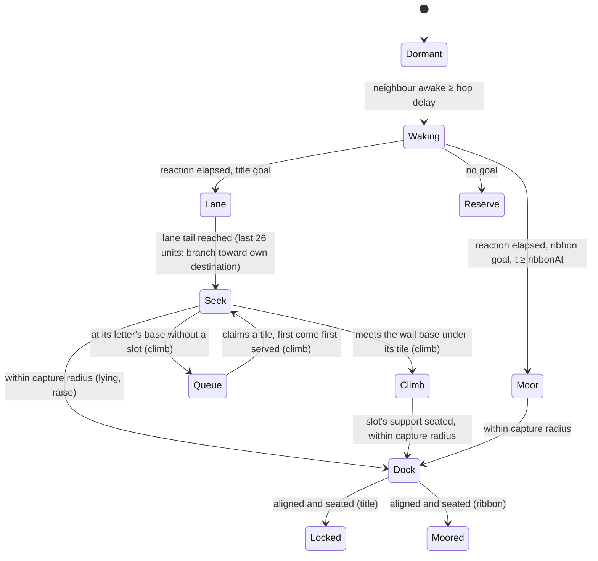

# Nanite swarm behaviour: intro first, gameplay next

> The [nanite design space](../nanite/README.md) owns what a nanite looks like: form,
> materials, articulation and the reactor core. This document owns swarm behaviour and
> choreography. Since S0k the prototype renders a low-poly tetrahedral proxy of that
> direction (section 4); the single-unit rig and docking study still come before any
> production body.

Proposal and prototype, 2026-10-12. Extends the [director's brief](director-brief.md) and
[experience design](experience-design.md). The S0 to S0k prototypes are
[spikes/swarm_intro](../../../spikes/swarm_intro/README.md).

User direction, the same day:
- The final CRUCIBLE title **stands upright**; ground-based assembly is acceptable for early
  milestones.
- Units decide their slot at the base, in arrival order, with no preset order.
- They work through conflicts by queueing, waiting and selective magnetism.
- The sequence may run to **15 s**.
- Tiles interlock into a solid join.
- Behaviour is recorded through Sub0Log's JSONL diagnostics.
- Climbing is closest to the intent, but the drawbridge stays active, to combine with
  climbing for some parts: an "ultra hybrid".
- Nanites can morph their triangle a little so complex outlines interlock with smooth edges.
- Each iteration is pushed and merged.
- 2026-10-13: the intro felt rushed; play it at about 66% speed so the climbing reads, using
  the room the sequence length allows.
- 2026-10-13, backlog: decision LOD need not be only view-driven; it could follow activity.
- 2026-10-13: consider 3D tessellation (section 5, S0i).
- 2026-10-13: the nanite moves from a flat triangle to a 3D shape like the original
  concepts (section 4, S0j).
- 2026-10-13: consolidate the design updates: the nanite design space (PR #44) owns the
  unit's form, and the prototype's body follows it as a proxy (section 4, S0k).

Sections 4 to 6 cover these. Times in this document are **choreography seconds**: the
authored beats. At the default pace of 2/3 a viewer sees each 1.5× longer, so the 15 s
sequence plays over 22.5 s (section 4). Nothing here changes gameplay
rules, the biomass ledger or Phase14 gates. Every later stage is a reviewable proposal and
is not dispatched by this document.

## 1. Gap: the intro's swarm behaviour was undefined

The Phase15 plan and brief define what the intro must **look like** and **when**: six
timed shots, wedge material and light, title-mask readability, skip and reduced-motion
policy, fidelity tiers (at most 4096 live instances balanced, 16384 cinematic) and the rule
that decorative intro nanites are view-owned and never impersonate the gameplay population.
Package P15-E0 owns "deterministic twelve-second wordmark choreography".

They do not define **how the nanites behave**. Before this proposal nothing specified:

- how the answer wave travels (which unit wakes whom, at what rate);
- which nanite goes to which slot, and in which order, so streams do not cross or block;
- how lanes form and how units leave them for strokes;
- how units avoid passing through one another, and where that is allowed to be cheap;
- how per-unit intelligence is shown, and which units pay for it;
- how docking, locking, surplus units and the ribbon work;
- how decision level of detail (LOD) relates to the camera, and why it cannot change the outcome;
- which ECS components, systems, ordering and structural-change points implement it;
- how this architecture extends into gameplay without breaking determinism or replay.

This document closes that gap for the intro and proposes the path to gameplay. It is
recorded as finding P15-F10 in the [Phase15 review](../../sprint-reviews/phase-15.md).

## 2. Prior art

| Work | What it contributes here |
|---|---|
| Disney Animation, *Big Hero 6* microbots: "Procedural Animation Technology behind Microbots in Big Hero 6" (Byun, Falt, Frost, Ali, Daniels, De Mund, Kaschalk; SIGGRAPH 2015 talk) | Tens of millions of small robots joined by electromagnetism, rearranging by sliding over one another. Disney's answer to directing them precisely was custom procedural animation algorithms. We adopt the same split: authored intent, procedural local rules. We also borrow their sliding: moving units glide over resting ones instead of colliding with them. |
| Rubenstein, Cornejo, Nagpal, "Programmable self-assembly in a thousand-robot swarm", *Science* 345 (2014) | 1024 Kilobots formed shapes from purely local rules, starting from a few seed robots: a hop-count gradient, local localisation and edge-following. Our answer wave is that gradient, and the first wedge is the seed. Their shapes took hours, a reminder that cinema compresses time by planning centrally. |
| Turpin, Michael, Kumar, "CAPT: Concurrent assignment and planning of trajectories for multiple robots", *IJRR* 33 (2014) | For interchangeable robots, assigning goals to minimise summed squared distance makes synchronised straight-line paths collision-free. The decentralised variant, d-CAPT, has neighbours exchange goals locally. We pair a central plan at load with local d-CAPT swaps. |
| Reynolds, "Flocks, herds and schools" (SIGGRAPH 1987) | Separation, alignment and cohesion: the near tier's reactive layer. |
| van den Berg, Lin, Manocha, reciprocal velocity obstacles (2008), and ORCA (2011) | Choosing a velocity from predicted time-to-collision gives visible anticipation and yielding. The hero tier samples velocity obstacles. |
| Treuille, Cooper, Popović, "Continuum crowds" (SIGGRAPH 2006) | Density and flow fields replace pairwise interaction for large crowds. The far tier uses a per-cell density gradient. |
| Müller et al., "Position based dynamics" (2007) | Iterative projection keeps a non-penetration constraint stable at fixed cost. |
| O'Sullivan et al., "Levels of detail for crowds and groups" (*Computer Graphics Forum*, 2002); Massive (Weta) crowd brains | Behaviour detail can be spent where the viewer looks. Massive gave each crowd agent its own fuzzy-logic brain. |
| Trautman, Krause, the "freezing robot problem" (IROS 2010) | Agents that are too cautious in dense crowds stall. The S0 prototype reproduced this; see findings. |
| Romanishin, Gilpin, Rus, M-Blocks (IROS 2013); Goldstein, Mowry, Claytronics (CMU); Werfel, Petersen, Nagpal, TERMES (*Science* 2014) | Modular self-assembly by pivoting or climbing over neighbours, programmable matter, and stigmergic construction. These are the vocabulary for later gameplay forms (section 10). |
| Drone light shows (Intel Shooting Star and successors) | Offline-planned assignment and trajectories for hundreds of real units forming logos: the production precedent for a central plan with live execution. |

The Big Hero 6 and Kilobot facts were checked against the
[SIGGRAPH history record](https://history.siggraph.org/learning/procedural-animation-technology-behind-microbots-in-big-hero-6)
and the [Harvard SEAS release](https://seas.harvard.edu/news/self-organizing-thousand-robot-swarm).
Other citations are from the author's knowledge. Verify them before any external publication.

## 3. Principles

1. **Intelligence is legibility of intent, not compute.** A nanite looks intelligent when
   its intent can be read: it turns toward its goal before moving (anticipation), yields
   or sidesteps visibly, trades places with a neighbour, and docks with a deliberate
   rotate-then-slide. Every unit runs the same rules. LOD decides how much of that mind is
   evaluated per tick, not who the unit is.
2. **Spend the decision budget where the camera looks.** Decision LOD is separate from
   render LOD. A hero unit makes full per-unit choices; a far unit follows a field. Hidden
   units move analytically.
3. **Every tier guarantees something.** Visible movers never pass through one another.
   Hidden units may, and must be resolved before they can be seen. Every tier reaches the
   same final arrangement.
4. **Plan centrally, act locally.** Assignment, lanes and timing are authored at load;
   the live behaviour is local and reactive. This gives art direction and timing guarantees
   with emergent texture, as in *Big Hero 6* and drone shows.
5. **Deterministic and view-owned.** Fixed tick, seeded personality, a frozen gather each
   tick and identity-ordered serial passes. The intro owns its own ECS world. The camera
   is scripted, so camera-driven LOD stays reproducible.
6. **Structural change at tick boundaries only.** Tier migration happens after all systems
   finish, with hysteresis, so partition churn is bounded.

## 4. Intro architecture (S0, implemented)

### Components and partitions

`Identity{index, seed}`, `Pose{x, y, z, heading}`, `Motion{vx, vy}`,
`Mind{act, lane, goal, ribbon, actSince, laneS, laneOffset, speedScale, reaction}`, and
exactly one tier tag. Queries are declared per tier, so Sub0ECS keeps a partition per
tier, and a tier system costs time proportional to that tier's population.

### Ordered tick (60 Hz fixed)

| # | System | Reads | Writes | Notes |
|---|---|---|---|---|
| 0 | Camera | timeline | camera | Scripted lens path: macro, pullback, rise, hold, open |
| 1 | Gather | ECS | frozen arrays, grid | The tick-start epoch every later system reads |
| 2 | Signal | gather | own `Mind`, wake time | The answer wave; order-independent |
| 3 | Behaviour ×4 | gather | own `Pose`/`Motion`/`Mind` | One system per tier partition (Jacobi, parallel-safe per row) |
| 4 | Negotiation | gather | `Mind.goal` pairs | Serial identity-ordered d-CAPT swaps; the only cross-row write |
| 5 | Resolve | post-behaviour poses | visible movers' poses | Projection with a fixed number of passes |
| 6 | LOD | poses, camera | tier tags (structural) | After all systems; hysteresis; hero cap |
| 7 | Metrics | ECS | diagnostics | Advisory; excluded from tick cost |

Rows 2 to 5 are where Sub0Pipeline row-range parallelism can be applied later. Each writes
only its own row, except the serial negotiation pass.

**Pace.** Every beat, speed and timer is authored in choreography seconds. A tick still
presents 1/60 s, but advances choreography by `tickSeconds × pace`. The default pace of 2/3
plays the whole sequence at 66% speed (S0g, user direction): 15 s of choreography over
22.5 s on screen, with nothing retuned. A slower pace means smaller simulation steps, never
larger ones than the 60 Hz the behaviours were tuned at. Timers that were tick counts
(stuck detection, push duration) are now seconds. The finer step exposed two latent
climbing faults, both fixed (SW-F19, SW-F20).

### Act state machine

The rest layer is Dormant, Dock, Locked, Moored and Reserve. Movers glide over it with a
cosmetic climb height `z`, which the renderer lifts and shades. In the climb build,
climbers also flow over each other in layers rather than colliding (section 5).

### The nanite's body in the prototype (S0j, S0k)

The unit's form is specified in the [nanite design space](../nanite/README.md), not here: a
compact silver tetrahedral shell (vertex hubs, edge rails, recessed face shields) around one
rigid tetrahedral core, with a stable housing and a living crystal inside it in the latest
[reactor study](../nanite/reactor-and-factions.md). The prototype renders a low-poly
**proxy** of that direction. This section records only what the swarm consumes and how the
proxy maps onto the build.

| Concern | Prototype contract | Owner |
|---|---|---|
| Stacking height | One layer is 0.55 d: the rest-layer lift for climbers flowing over each other and the depth of a tessellation layer (S0i). The proxy's apex stands at this height, so the S0k swap left every state hash unchanged | `NaniteBody::height`, consumed by the simulation |
| Docking envelope | A locked unit's footprint is its morphed title tile (S0e); the shell's base is that tile, so neighbours share base edges and the letter's footprint stays gap-free | This document (build) |
| Visual form | Proxy only: the shell, its parts and the core are view-owned decoration in `nanite_mesh.py`; they do not claim the articulated unit tessellates or climbs | [Nanite design space](../nanite/README.md) |

S0j first gave the prototype a body from the original concepts, a slender arrowhead dart
with a raised spine and a core set into the roof. The design space's review of PR #43
([single-unit study](../nanite/single-unit-study.md)) found it read as a roof on a tile with
a core painted onto two facets, and set the tetrahedral direction. S0k replaces the dart in
the renderer with a proxy of that direction:

- **Shell:** a tetrahedron whose base is the unit's footprint (an equilateral triangle
  1.1 d on a side when free, its tile when locked) and whose apex stands one stacking layer
  high, leaned toward the nose so the low oblique body reads its heading.
- **Parts:** each face splits into three graphite hubs, three silver edge rails and three
  shield segments recessed below the face plane around a window. All four windows open onto
  the same core; through them the shell's dark inside frames it.
- **Core:** exactly one regular tetrahedron, base down, under the apex and clear of the
  surface. Its edge is 0.40 of the shell's mean base edge, clamped to keep 0.04 d from every
  shell face (a squat docked shell on a large tile bounds it). Faces are flat cyan, each one
  tone, restrained; a locked core settles to a steady glow, subordinate to the silver.

Seen from above, a free unit is a triangle with its apex inside it, the silhouette the
design space's core study asks for. A docked letter reads as a field of faceted pyramids
with cyan glimpses, like the hero concept.

The proxy does not attempt the parts that need a rig: articulated edge fingers, shield
opening, the three-point oblique rest, the underside inspection view, or the housing and
inner crystal of the reactor study. A free unit still snaps to its tile footprint when it
locks; a gradual morph is S1. Rendering stays a 2D stand-in: one key light, flat shading
with a controlled highlight, back faces culled, bodies painted far to near, no shadows or
real-time materials.

Detail follows on-screen size, after the brief's tactical LOD (silhouette and core location
first, SW-F27). From 6 pixels per unit, bodies are meshes with open windows. From 14 px,
shells split into hubs, rails and recessed shields with seams. Below 6 px units are
silhouettes (the shell's base), below 3 px points. The design space asks for these
thresholds to be re-evaluated with the final silhouette.

### Decision tiers

| Tier | Who | Behaviour | Guarantee | Cost driver |
|---|---|---|---|---|
| Hero | At most `heroCap` (128) movers nearest the focus, at ≥10 px per unit | Sampled velocity obstacles against senior neighbours; anticipation; climb; nuanced turns; docking ritual | No visible pass-through; intent readable | Candidates × neighbours |
| Near | Visible, ≥6 px per unit, inner 80% of frame | Desired velocity plus separation; climb | No visible pass-through (with resolve) | Neighbour query |
| Far | Visible, outer frame or sub-6 px | Density-gradient push, O(1) | Resolve keeps contacts glancing | One cell lookup |
| Hidden | Outside view plus margin | Analytic goal motion | Same goal and timing; resolved on entry | None |

Render LOD (mesh detail, core glow, shadow) is chosen independently from pixels per unit.

**Backlog: activity-driven decision LOD** (user suggestion, 2026-10-13). Tiers follow the
camera today, but on-screen size is only a proxy for "a decision here would be noticed".
Activity is a more direct signal: a unit claiming, docking, clinging, climbing a corner,
stuck or contended needs full decisions even when small on screen, while one cruising an
empty lane at full speed does not even when large. A score could weigh view (pixels per
unit) and activity (act, local density, contention, time since progress), with the hero cap
and hysteresis kept. Two consequences need measuring before adoption:
- Activity-only tiers depend on simulation state, not the camera. That would make decision
  LOD deterministic and replay-safe on its own, which matters for gameplay (section 9),
  where camera-driven LOD may never decide outcomes.
- Visible units in "calm" acts would drop to the far tier and its density-gradient push.
  Their motion must still read well at close range: the hero view is where cheap behaviour
  is easiest to spot.

S3 compares camera, activity and blended tiers on the same seeds: contacts, stuck episodes,
completion time and cost.

### Planner

At load, a BFS from the first wedge predicts wake order with the same rule the signal
system executes. Slotted units split across three lanes by bed position, so lanes never
cross. Within a lane, units in wake order pair with slots in far-first order, so early
arrivals fill strokes behind later paths. Ribbon units are next in wake order. The
remaining units stay on the bed as a reserve that wakes and settles.

## 5. Standing the title upright

The brief's hero is a nearly frontal, readable title. Building it upright means units must
leave the ground and interlock against gravity. That adds three questions the lying build
never had: what supports a unit before its neighbours exist, how units reach a slot high
on a face, and whether this fits the twelve-second timeline. S0b and S0c test two answers.

| | S0b/S0d: climb in place | S0c: assemble flat, then raise |
|---|---|---|
| Idea | Letters grow bottom-up where they stand, like a TERMES structure or a Kilobot shape. Units climb the face of what is already built. | Each letter assembles flat behind its baseline exactly as in S0. When its last unit locks, the interlocked letter hinges up on its bottom row like a drawbridge. |
| Order | None preset (S0d): units queue at their letter's base and claim the lowest supportable tile nearest them, first come, first served. | Planned slots, as in S0. |
| Support | A tile is fillable only from the ground or a locked lower neighbour. Locks never happen unsupported (verified). | The letter is one rigid interlocked body during the rise, pivoting on the ground row. |
| Surfaces | Two connected 2D surfaces: ground and wall face, joined at the base. Climbers route over built units (shortest path, strokes linked through the ground), drawn up by lift magnetism, and flow over each other in layers. | One surface (ground); the rise is a pose transform of locked units. |
| Title complete (1536 units) | 11.01 s (S0b with a preset order: 13.45 s) | 7.73 s flat; every letter upright by 8.79 s |
| Cost (host p50 / p95 per presented tick) | 0.41 / 2.55 ms | 0.22 / 2.14 ms |
| Reads as | The swarm literally builds the word, letter tops last. Strong "engineered material" story. | A flat assembly that stands up in a rolling wave, letter by letter. Dramatic; keeps the twelve-second timing. |

### Hybrid: climbing with drawbridges (S0e)

Each letter now has its own build mode. In the hybrid build, letters whose build depth is
above the median assemble flat and swing up as drawbridges; the others climb. Depth is the
climb's critical path, and here that means C, R, C and E (chosen automatically; a mask
overrides). Most of the swarm still queues, claims and climbs. Raised letters use planned
slots, and the two modes never trade slots.

| Upright build (1536 units, 1,066 morphed tiles) | Title complete | Worst ground contacts | Tick p50 |
|---|---|---|---|
| Climb (S0d) | 11.01 s | 0% | 0.41 ms |
| Hybrid (S0e) | 9.17 s; raised letters upright by 8.14 s | 0% | 0.14 ms |
| Scaffold (S0f) | 10.21 s; stem panels upright by 8.04 s | 0% | 0.48 ms |
| Raise (S0c) | upright by 8.79 s | 0% | 0.22 ms |

Choreography seconds at pace 2/3 (S0g) with lane branching (S0h); multiply by 1.5 for time
on screen.

### Scaffold: per-part drawbridges during the climb (S0f)

The per-part hybrid makes the drawbridge a building step inside the climb. Tall, straight,
upright strokes standing on the baseline become panels: the R's stem and leg, the I, and
the B, L and E stems. They assemble flat, swing up first, and become the scaffold the swarm
climbs to finish the arms and bowls. Deep letters without such a stroke (the two Cs) raise
whole; the U climbs.

A raised tile is wall support only once its panel is upright, and climbers route over it at
its standing position. Arm tiles may be claimed while their stem is still flat, so units
wait at the base and go up as it swings. A climber starts up only when some path from the
ground reaches its slot without crossing a panel that is still flat or rising (S0g). Before
that rule, climbers went up beside a lying stem and hung off the face until it rose.

**Recommendation, revised: the scaffold build for the director's review.** It completes at
10.21 s (15.3 s on screen at pace 2/3), with climbers on the built face and no visible
contacts. It keeps
climbing as the core, since the swarm still climbs every arm, bowl and the U. And it turns the drawbridge into a structural beat: stems swing up as
scaffolds the swarm then climbs. The hybrid (whole letters) and pure climb remain variants;
raise is the twelve-second fallback.

### Three-axis interlocking: 3D tessellation (S0i)

S0b is the "surface" interpretation: units move on surfaces and interlock within a plane.
S0i adds the depth axis with the smallest change that keeps every rule: **layers of the
same tiling, staggered.** A nanite is a wedge, a triangular prism, so stacking the triangle
tiling in depth tiles space (the triangular prism honeycomb). Stacked straight, layers
would be loose sheets. Every odd layer therefore sits on a lattice shifted half a side
along the title, so each wedge overlaps two or three wedges of the layer behind: a
staggered bond, like brickwork, interlocking front to back.

The build graph gains **face links** between overlapping wedges of adjacent layers. The
support rule is unchanged: a tile needs the ground or a locked neighbour of lower build
depth. Depth now counts through face links, so a front-layer tile can be held by the face
of the layer behind it as well as from below. Climbers route over the face links as over
any other link. Flat assembly (raised panels and letters) seats a front wedge only on a
locked wedge of the layer behind in the same flat body. A panel's edge wedge with none of
its own panel behind it overhangs, carried by the rigid panel; waiting on a climbed tile
there deadlocked a panel's rise.

Twice the tiles through the same stage needed two capacity rules, each scaling with the
layer count so a single layer is unchanged (bit-identical state hashes):
- lane width, since flow is density × width × speed;
- each letter's waiting band, where a two-layer letter's climbers now heap and flow over
  each other, as the seekers at the wall's base already do. Without the heap, the U's 300
  climbers packed into contact (6–8% of visible movers).

| Two layers, 2,146 tiles, 3,072 units (layers one body thick, S0j) | Title complete | Upright | Contacts |
|---|---|---|---|
| Lying | 8.42 s | – | 0.06% |
| Raise | 8.49 s flat | 9.54 s | 0.24% |
| Climb | 10.78 s | – | 0.15% |
| Hybrid | 9.31 s | 8.72 s | 0.12% |
| Scaffold | 10.68 s | 8.59 s (panels) | 0.32% |

Every gate holds at two layers, including no unsupported lock, climbers on the built face,
and the 12.5 s completion. Three layers (3,212 tiles) reach 3,211 by 15 s: the last tile is
an enclosed pocket on the front layer whose climber cannot get in. TERMES-style
construction avoids exactly this with a no-enclosed-holes rule in the build order, the
follow-up before more than two layers. Overhangs and climbing round edges onto the back
face remain with the gameplay structures (G-stages).

## 6. Cooperation, magnetism and diagnostics (S0d)

**No preset order.** In the climb build the planner gives a unit only a destination letter.
At the letter's base the unit joins a queue, and a serial claim system (deterministic:
arrival tick, then identity) hands out tiles. A tile is claimable once it could soon be
supported: on the ground row, or with a lower neighbour locked or claimed. The unit gets the
lowest such tile nearest it, with up to 96 claims in flight per letter. Claims run just in
time, and the final decision is made at the base.

**Stuck intelligence.** Every unit measures its own progress. After 40 ticks without
progress it chooses one of three responses:
- **Wait**, when a senior unit beside it is still moving: it is simply in a queue.
- **Push**, otherwise: repelling magnetism for half a second, so juniors and idle units step
  aside.
- **Reclaim**, when still stuck after three times as long: release the tile, then rejoin the
  queue (a seeker) or take the nearest supported free tile (a climber).

In the climb run all 50 stuck episodes recovered (median 8 ticks), none needed a reclaim,
and nothing is stuck at the end (a gate).

**Selective magnetism.** Lift: in contact with the built face, the structure draws a climber
up (1.6× climb speed); it also holds a climber clinging beside an unsupported tile. Push:
the contingency above. Seat: a climber whose tile is supported is pulled in until it locks.
Modes are exclusive and every transition is an event.

**Solid join.** Tiles are equilateral triangles of side √3 diameters, alternating up and
down on a lattice clipped to the strokes. A finished letter is one gap-free face of 1,104
tiles. Support through shared vertices makes the build shallower than stroke rows (13–17
levels instead of 22). A tile looks the same every 120°, so seating turns at most 60°.

**Morphing tiles.** Locked units morph their triangle so a letter's outline follows its
strokes:
- A notch between two tiles in a row is filled, and a tile held by a single edge is trimmed.
- Each lattice corner on the outline moves toward the true outline by at most 0.35 of a
  side; ground-row corners stay grounded.
- A quality pass scales back corner moves until every tile keeps at least half its area.

Moves belong to corners, not tiles, so neighbours always agree and joins stay seamless.
Outline error falls 51% (RMS 0.624 to 0.308 units over 408 outline corners). It is gated:
no tile below half its area, and at least a 40% cut.

**Diagnostics.** A bounded in-memory Sub0Log segment records eight numeric event types:
claim, lock, stuck, recovered, magnet, letter, summary and supported. They are exported
after the run as upstream schema-1 JSONL with a health receipt, following Crucible's runtime
diagnostics pattern. An independent Python receiver checks them against each other and
against the run summary, in CTest for every build.

They found the climb's real bottleneck. `supported` events showed owners a median 6 units
from a tile when it became supported. Frame traces then showed climbers braking at every
waypoint. Fixing that took the climb from not finishing in 16 s to 11.8 s. This is the
second consumer of Sub0Log's JSONL path in Crucible, and the first with high event volume:
about 9,100 records per climb run, with no drops in a 4 MiB segment.

## 7. Prototype results

The [spike README](../../../spikes/swarm_intro/README.md) has commands, gates, the evidence
table and images for every build. With camera LOD, 1536 units and pace 2/3 (choreography
seconds; on screen is 1.5× longer):
- **Lying:** complete at 7.66 s (brief: 8.4 s), the ribbon by 10 s.
- **Raise:** upright by 8.79 s.
- **Climb:** complete at 11.01 s, no climber off the built face.
- **Hybrid:** complete at 9.17 s.
- **Scaffold:** complete at 10.21 s, stem panels upright by 8.04 s; 3 of 33,327 climber-ticks
  off the face.
- **Every build:** no visible contacts (centres closer than 0.8 diameter) and no pair closer
  than 0.8 diameter, since lane branching (SW-F21).

Ticks run 0.11–0.48 ms p50 per presented tick on a shared cloud host. 16,384 units still
meet every deadline. Release, Debug and ASan/UBSan pass all ten CTest cases with identical
state hashes.

### Findings that shape the next iterations

| ID | Finding | Consequence |
|---|---|---|
| SW-F1 | Reciprocal avoidance on every unit froze dense streams: 82% complete at 10 s. Right of way by wake order fixed it, but uniform hero stays 3.8 s slower and about 7× the cost. | Heroes stay few and embedded in a reactive stream. Right of way is part of the hero rule. Hero count also affects timing, not only cost. |
| SW-F2 | Lane throughput (width × speed) bounds the assembly time. | Lane width and pace are authored parameters reviewed with the camera, not emergent. |
| SW-F3 | Local d-CAPT swaps cut contacts and time. | Keep swaps. In hero view they read as negotiation, a cheap intelligence cue. |
| SW-F4 | The polling signal system dominates at 16K. | S3: event-driven wave front (only frontier neighbours test). |
| SW-F5 | Up to 70 locks per 100 ms. | Audio uses authored beats and aggregated density, never per-lock sounds (matches the brief). |
| SW-F6 | Release, Debug and ASan builds share each build's state hash on GCC 13. | Determinism is promising; cross-compiler equality is not claimed. Skip can jump to an authored settled state without replaying. |
| SW-F7 | With a preset order and stroke rows, honest bottom-up climbing completed at about 13.5 s; build depth × per-level latency is the critical path. | Superseded by SW-F10 under the 15 s allowance. |
| SW-F8 | Climbing worked only with sheet-by-act, ground staging, layered flow on the face, shortest-path surface routing and pipelined seating. | These five rules are the climbing vocabulary for gameplay structures. |
| SW-F9 | Assemble-flat-then-raise is upright by 9.2 s at lying-build cost. | Twelve-second fallback; the raise would replace the brief's camera rise as the shot04/05 beat (director decision). |
| SW-F10 | First-come claiming, momentum through waypoints, clinging beside unsupported tiles and a flowing heap at the base complete the climb at 11.8 s. | Recommended intro build for the 15 s sequence. |
| SW-F11 | Stuck detection with wait, push and reclaim resolves every episode in these runs. Whole-lane car-following was rejected: lanes from rest jammed and the lying build slowed from 8 s to 15 s. | Contingency is local and episodic; queueing belongs at the base, not in the lanes. |
| SW-F12 | Tessellation gives a solid face and a shallower build; equilateral tiles leave a stepped outline. | Addressed by morphing (SW-F16). |
| SW-F13 | The climb build's lane exits crowd: up to 9% ground contacts at 1536 units, about 12% at scale. | Resolved by lane branching (SW-F21). |
| SW-F14 | Sub0Log JSONL diagnostics found the climb bottleneck and verify event integrity per build. | Keep event schemas with each behaviour stage; use `supported` latency as the climb's tuning metric. |
| SW-F15 | Raising the deepest letters while the rest climb halves the ground crowding (4.3% against 9.1%) and finishes slightly sooner (11.2 s against 11.4 s). | A variant; per-part drawbridges (SW-F17) go further. |
| SW-F17 | Per-part drawbridges (scaffold) completed the climb at 10.75 s (pace 1; 11.23 s at pace 2/3 with every climber on the face, SW-F20). Raised tiles must support only when upright, at standing positions; flat stems may already be claimed against. | Recommended intro build; stroke selection is authored data in S2. |
| SW-F18 | Climbers stepping onto the wall over a gap between strokes hung off the face; entering beside a standable ground tile fixed it and sped pure climbing to 11.4 s. | Entry points are part of the climbing vocabulary. |
| SW-F19 | Slowing to pace 2/3 by finer steps, not retuning, kept every gate but exposed latent faults: a climber carried waypoint momentum around a corner and overshot three units into the R's counter; a ribbon unit sent across the stage moored late. | Waypoints brake into corners by look-ahead (stop within the waypoint distance plus a run-on that shrinks with the turn); ribbon moorings are matched by x rank. Climbing got faster too: climb 11.42 s, hybrid 10.66 s. |
| SW-F20 | Counting flat-locked panel tiles as "built" let climbers start up beside a stem still lying down; they hung off the face (1.2% of climber-ticks). Waiting on one BFS support chain instead fixed that, but delayed the R to 12.9 s, because its chain ran through the late leg. | A slot is climbable once any path from the ground reaches it without crossing a panel not yet upright (one BFS per panel change). Scaffold: no climber off the face, complete at 11.23 s. |
| SW-F21 | 93% of contacts were between lane units and fresh seekers at the exit of the C-R-U lane, where the S0 funnel narrowed the stream to a third of its width before it split three ways. Leaving the lane over its last 26 units, each unit heading straight for its own destination, splays every lane into a fan sorted by destination. | Contacts 0% in every build (climb was 9.8%), minimum gap 0.8 d or more; all builds faster (scaffold 10.21 s, hybrid 9.17 s). Branch length swept 8–40: 26 is the shortest with no contacts and keeps the lanes readable (shot02). Climbing gates tightened to 3% and 0.5 d. |
| SW-F22 | With branching, negotiation swaps became common and the lying build logged 161 stuck episodes from units running at full speed: progress was measured against the goal held before the swap. | The progress baseline resets on a goal change as well as an act change. Stuck detection must follow the decision it measures. |
| SW-F23 | Staggered layers of the same tiling give 3D interlocking with the existing support rule: face links between overlapping wedges of adjacent layers carry depth through the bond. Two layers (2,146 tiles, 3,072 units) pass every gate; scaffold completes at 10.68 s. | S0i; `--layers 2`. The intro can carry depth if the director wants a title with thickness; the cost is units (twice the tiles) and per-tick time (scaffold p50 1.1–1.3 ms against 0.5 ms). |
| SW-F24 | Doubling the tiles crowded the stage: wider lanes alone fixed lying and raise; climbing letters' waiting crowds needed to heap (flow over each other) like the wall-base heap. Panels deadlocked once when a front panel wedge waited on a climbed wedge behind it. | Capacity rules scale with the layer count; face backing for flat assembly counts only the same flat body. |
| SW-F25 | Three layers leave one enclosed front-layer pocket unfilled. | A no-enclosed-holes build order (TERMES) before more than two layers. |
| SW-F26 | A 3D body with vertical walls on the tile footprint keeps the tessellation gap-free in 3D with no change to the build: neighbours share wall quads, the roof facets form the seams. The concept dart (spine, faceted roof, core in the spine) works on any triangular footprint, so free darts and locked tiles share one construction. The existing stacking step (0.55 d) is the spine height. | S0j; one body specification (`NaniteBody.hpp`) feeds the simulation and the renderer, tested for parity. The dart form was superseded by the design space (SW-F28). |
| SW-F28 | A tetrahedral proxy of the design space's form fits the build unchanged: the shell's base on the tile keeps the letter's footprint gap-free, and an apex one stacking layer high left every state hash identical. A regular core sized from the base edge poked through the squat shell on large tiles (up to 0.06 d) and is clamped to clear every face. | S0k; the form lives in one place (the design space), the swarm keeps the height and the docking envelope. The rig, the underside and the reactor housing need the single-unit study, not the swarm renderer. |
| SW-F27 | Full seams and recess rings at title distance (8 px per unit) turned the letters to texture. | LOD the details, not just the mesh: silhouette and core first, seams only close up (brief: tactical LODs preserve silhouette and core location). |
| SW-F16 | Corner morphing of up to 0.35 side halves the outline error with every tile keeping half its area; larger limits add little. Fill and trim of spikes were prerequisites. | Default morph 0.35; faint steps on some stems are the place for a sub-tile edge piece; a gradual morph while seating belongs to S1. |

## 8. Iteration plan: building blocks with review gates

Each stage is small, has a named consumer, ends with captures and a review, and can change
the next stage. Stages S1 to S3 are intro work under P15-E0 and R0. G-stages are
post-journey gameplay proposals.

| Stage | Increment | Consumer | Review gate |
|---|---|---|---|
| **S0** done | Headless ECS swarm, tiers, wave, planner, lanes, docking, resolve; lying title; 2D captures | This review | User reviews beats, tiers and findings; agrees on the behaviour vocabulary |
| **S0b** done | Upright by climbing: support rule, build graph, two-surface climbing, staging, layered flow, surface routing, pipelined seating | This review | Records why honest climbing misses the brief's timing |
| **S0c** done | Upright by raising: flat assembly, then each letter hinges up on its baseline | This review | Twelve-second fallback |
| **S0d** done | Climb without a preset order: first-come claims, stuck contingencies, selective magnetism, tessellated solid tiles, Sub0Log JSONL diagnostics with an independent receiver; 15 s sequence | This review | Climbing confirmed as the core intent (user) |
| **S0e** done | Hybrid build (per-letter drawbridge or climb) and morphing tiles for smooth outlines | PR #38 | Merged with S0–S0d |
| **S0f** done | Scaffold build: per-part drawbridge panels (grounded stems) climbed to finish arms and bowls; standing support; entry beside standable ground tiles | PR #39 | Merged |
| **S0g** done | Pace 2/3 (the sequence at 66% speed, 22.5 s on screen); corner braking by route look-ahead; climbable-path gate for scaffold panels; ribbon rank matching; `render_swarm.py --mp4` | PR #40 | Merged |
| **S0h** done | Lane branching: units leave the lane over its tail for their own destinations (SW-F21); progress baseline per goal (SW-F22); tighter contact gates | PR #41 | Merged |
| **S0i** done | 3D tessellation: staggered depth layers, face links, face backing for flat assembly, capacity scaled by layers; renderer yaw, layer shading and tile edges | PR #42 | Director reviews whether the title has depth (one or two layers) |
| **S0j** done | 3D nanite body: one specification for simulation and renderer; beveled wedge with recessed core; mesh renderer with lighting, culling and detail LOD; mesh invariant tests | PR #43 | Merged; the form was reviewed in the design space (PR #44) and superseded |
| **S0k** done | Design consolidation: the design space owns the form; the renderer's body becomes a tetrahedral proxy (shell, hubs, rails, recessed shields with windows, one regular core inside); simulation unchanged | This review | Director compares the proxy with the core-corrected form study (macro and title close-up) |
| **S1** | Production renderer consumes a per-tick instance packet (world pose, plane tilt, lift, act, core intensity, render LOD) from the chosen build; perspective lens path from the brief | P15-R0 Filament scene | Native capture against hero and storyboard concepts; bodies grounded; upright title readable with bloom off and in grayscale |
| **S2** | Choreography authoring: which strokes are panels, as authored data (SW-F17); sub-tile edge pieces where stems stay stepped (SW-F16); lanes and stroke order as data; the raise beat if raise is chosen (what visibly lifts the letter: a wave of units pushing under the hinge, rise order and easing); optional hero-letter climbing finish; climb arcs; traveling cyan accent; idle micro-behaviour for locked heroes (breathing core, settle wobble); skip jumps to an authored settled snapshot; reduced motion selects the still | P15-E0 frontend | Director pass (brief section 8); skip and reduced-motion receiving; temporal review of motion, not stills |
| **S3** | Performance and decision LOD: activity-driven and blended tiers against camera tiers (section 4 backlog); event-driven wave; Sub0Pipeline row ranges for behaviour and resolve; hero candidate cap per frame; optional GPU compute route for far and hidden tiers | Named device | p95 and p99 inside the brief's proposed 16.67/20 ms with rendering included; measured, never inferred from S0 |
| **S4** | Upstream feedback: tier tag migration cost and partition churn in Sub0ECS; frozen gather and grid as a reusable pattern only if a second consumer appears | Sub0ECS | Measured reproduction; no speculative API |
| **S5** | Menu backdrop: the ribbon idles cheaply behind the menu, never as a live mission | P15-J0 menu | Zero gameplay ticks; stops under reduced motion |
| **G1** | Hero embellishment layer over gameplay nanites (section 9), view-owned, bounded deviation | P15-R1 mission view | Authoritative replay hash unchanged with the layer on or off |
| **G2+** | One mechanic from section 10 at a time, each with frozen rules and fixtures | Mission design | Per mechanic, as in experience design |

Iteration rule: after each stage, update this document's findings, re-tune the next stage,
and record any revision of the director's beats it caused. Behaviour vocabulary (wave,
lane, negotiation, docking, climbing, raising) is reused, not re-invented, in each stage.
Three-axis interlocking (section 5) enters with the first gameplay structure that needs
it, not before.

## 9. From intro to gameplay: authority and embellishment

Gameplay nanites are authoritative, replayed and deterministic. They cannot depend on the
camera, frame rate or window size. Camera-driven decision LOD may therefore never decide
a gameplay outcome. The proposal:

1. **Authoritative layer.** The existing uniform steering and field rules (Phase14,
   100K to 150K target) stay camera-independent. Any smarter gameplay behaviour is a rule
   applied uniformly, or to an explicitly commanded and recorded set of units.
2. **Embellishment layer.** A view-owned overlay, reusing the intro's hero tier near the
   camera. It adds anticipation turns, glances, yielding wobble, docking rituals and
   negotiation gestures as a bounded offset from the authoritative pose (for example
   ≤0.5 diameter and ≤30°, relaxed back within a fixed time). It never feeds back into the
   simulation, so replay hashes are identical with it on or off.
3. **Swarm-level mind.** Intelligence at strategic zoom is shown by the collective: flow
   lanes, fronts and density waves that respond to fields, not by individuals.

This keeps "each nanite appears intelligent" where it can be seen, and keeps 150K units
affordable, without risking replay divergence.

## 10. Future mechanics catalogue (documented, not dispatched)

Each candidate needs its own frozen rules, ledger impact, replay representation, fixtures
and participant evidence before implementation, as in [experience design](experience-design.md).

### Swarm-robotics and self-assembly

| Mechanic | Player value | Swarm basis | Main dependency or risk |
|---|---|---|---|
| Flow lanes (existing direction) | Route mass with one gesture | Lane following, d-CAPT | Already the core loop |
| Bridge / ramp forms | Cross gaps by spending mobile mass as structure | M-Blocks pivot-climbing; *Big Hero 6*; S0b climbing rules; S0c raising (a span assembled flat and tipped over a gap) | Terrain decision; traversal rules; ledger "anchored mass" |
| Wall / shield forms | Hold a Blight front temporarily | Fused lattice variants; S0b bottom-up support or S0c raise | Protection rule, duration and ledger |
| Tool forms (ram, scoop) | Break crust or carry substrate | *Big Hero 6* shapes | New interaction rule; strong readability need |
| Cooperative carrying | Move relay parts or objects | Collective transport | Object physics; quorum size rule |
| Tendrils / scouting chains | Reveal or probe at range | Chain formation | Fog-of-war rule (none exists) |
| Self-repair | Damaged lattice refills from the swarm | Kilobot edge-following refill | Damage model |
| Stigmergic markers | Units leave a decaying trail that recruits others | Pheromone fields; TERMES | Field-slot budget; determinism of decay |
| Quorum choice | The swarm chooses between two sites; the player biases it | Honeybee nest-site selection | Must stay explainable and controllable |
| Morphogenetic growth | Lattice grows organic patterns | Turing patterns | Growth ledger extension |

### Quantum strangeness

"Quantum" is game fiction, not a physics claim. These extend the existing candidate
table (Quantum Lens, Phase Pulse, Entangled anchors, Temporal rewind). Every effect must be
a recorded, deterministic command or rule. Observation by the camera never changes
outcomes; an explicit, recorded focus command may.

| Idea | Fiction | Mechanic | Determinism note |
|---|---|---|---|
| Superposition presentation | Unobserved nanites are a probability haze | The far and hidden tiers render as a shimmering density cloud that resolves into wedges as the camera approaches. LOD becomes the visual language. | Presentation only; free with the LOD architecture |
| Observation collapse | Measuring fixes the state | A recorded Focus command collapses a haze region into committed positions (e.g. ends a phase-shift ability) | Command in replay; never the camera |
| Tunneling | Units cross a thin barrier they cannot pass | A charge lets a stream cross a one-cell Blight crust with a fixed, seeded success rule | Seed and outcome recorded; ledger unchanged |
| Entangled pairs | Two linked units share a state | Paired anchors redistribute influence (existing candidate), or a sacrificed unit relocates its twin's role | No free biomass; capacity rule |
| Interference | Two flows reinforce or cancel | Overlapping fields of matching or opposing phase add or subtract strength | Integer field arithmetic; readability risk |
| Quantum Zeno hold | A watched state cannot change | A sustained recorded Focus freezes Blight spread in a small area at a charge cost | Charge and duration frozen first |
| Uncertainty lens | Precision trades against momentum | The UI shows exact positions or exact flow vectors, not both | Information only |
| Decoherence | Noise destroys quantum effects | Blight density shortens or cancels quantum abilities nearby | Gives Blight strategic texture |
| Many-worlds ghosts | Branches seen side by side | The Quantum Lens ghost previews (existing preferred spike) | As already specified |

Intro tie-in (optional, S2 director decision): a brief "haze resolves into wedge" beat
where distant units enter the frame. It must not cost title readability.

## 11. Open questions for review

1. Is the S0 vocabulary right for the brand: wave, lanes, negotiation swaps, glide-over
   climbing, rotate-then-slide docking? Should anything feel more organic or more mechanical?
2. Lane count and width: three wide lanes meet the timing; does the camera need narrower,
   more legible lanes at a slower pace (and so fewer slots or a later lock)?
3. Should surplus units stay as a visible bed reserve, or should the unit count match
   slots plus ribbon exactly?
4. Is the "superposition haze" presentation for distant units welcome in the intro, or
   reserved for the Quantum gameplay layer?
5. Which section 10 mechanic should be the first post-journey gameplay spike?
6. Upright build: scaffold (recommended, 10.2 s), hybrid (9.2 s), pure climb (11.0 s) or
   raise (8.8 s, the twelve-second fallback)? Which strokes should be panels? (Choreography
   seconds; 1.5× on screen at pace 2/3.)
9. Is 2/3 the right pace, and should it be uniform? Slowing only the climb (the stream-in
   could stay brisk) is a time warp of the choreography clock, cheap to author.
10. Should decision LOD follow activity as well as the view (section 4 backlog)?
11. Should the title have depth (S0i)? Two layers read as a solid slab from an angle and
    cost twice the units; a frontal camera barely shows them.
7. Does the raise beat replace the brief's camera rise toward a frontal baseline, or play
   under it?
8. Should the claim, stuck and magnet rules carry into gameplay as the authoritative
   cooperation model (deterministic and recorded), or stay intro-only presentation?
