# Nanite swarm intro spike

Headless, deterministic prototype of the CRUCIBLE title sequence's swarm behaviour: building
blocks S0 to S0f of the
[nanite swarm design](../../docs/concepts/phase15-experience/nanite-swarm-design.md).
It answers a narrow question: **can a few thousand view-owned nanites perform the
director's beats with intelligent-looking behaviour near the camera, cheap non-penetrating
motion elsewhere, and a deterministic outcome that does not depend on the level of detail?**

User direction, 2026-10-12:
- The final title **stands upright**; a ground-based build is acceptable for early milestones.
- Units decide their slot when they reach the base, in arrival order, with no preset order.
- They work through conflicts by queueing, waiting and selective magnetism.
- The sequence may run to **15 s**.
- Tiles interlock into a solid join.
- Behaviour is recorded through **Sub0Log's JSONL diagnostics**.
- Climbing is closest to the intent, but the drawbridge stays available to combine with it
  (the hybrid build).
- Nanites morph their triangle a little so complex outlines come out smooth.
- Each iteration is pushed and merged.

It is not production rendering, audio, a gameplay system or a native performance budget.
The images are concept2D/dev-test captures through stand-in cameras: top-down orthographic
for the lying build, and an oblique front view (screen height = z + 0.4 × depth) for the
upright builds.

## Five builds

| `--build` | Stage | How the title forms | Title complete (1536 units) |
|---|---|---|---|
| `lying` (default) | S0 | Units assemble the title flat on the substrate, each with a planned slot. | 8.12 s |
| `raise` | S0c | Each letter assembles flat behind its baseline. As soon as its last unit locks, the interlocked letter hinges up on its bottom row like a drawbridge, letters rising one after another. | 8.00 s flat, upright 9.05 s |
| `climb` | S0b, S0d | Letters grow upright in place, bottom-up. No preset slots: units queue at their letter's base and claim slots first come, first served. They climb the built face with lift magnetism, and recover from getting stuck by waiting, pushing or reclaiming. Uses the 15 s sequence. | 11.38 s |
| `hybrid` | S0e | Whole letters both ways. Letters whose build depth is above the median (the climb's critical path) assemble flat and swing up as drawbridges; the rest climb. Automatic choice here: C, R, C and E raise; U, I, B and L climb. `--raise-letters MASK` chooses by hand (bit 0 = first C). Uses the 15 s sequence. | 11.17 s; raised letters upright by 9.00 s |
| `scaffold` | S0f | Per-part drawbridges, combined with climbing. Tall, straight, upright strokes standing on the baseline become drawbridge panels: the R's stem and leg, the I, and the B, L and E stems. They assemble flat and swing up first as scaffolds, and the swarm then climbs them to finish the arms and bowls. Deep letters without such a stroke (the two Cs) raise whole; the U climbs. Uses the 15 s sequence. | 10.75 s; all 8 panels upright by 8.60 s |

The climb build runs on two connected surfaces: the ground and the wall face. The wall face
is stored as a second interaction surface, offset so the two never interact, and joined to
the ground along the wall's base. That is the "surface" interpretation of upright
assembly. Full three-axis interlocking (units attaching on any face, overhangs, depth) is a
later stage in the design.

## Tessellated title (solid join) and morphing tiles

Slots are equilateral triangles of side √3 diameters (each one's inscribed circle is one
unit). They sit on a triangular lattice clipped to the letters' strokes and alternate up and
down, so neighbours share edges and a finished letter is one solid, gap-free face. Square
stroke caps make every letter stand on the baseline with a flat edge. A tile looks the same
every 120°, so a unit seats at the nearest equivalent heading: flipping between an up tile
and a down tile costs 60°, not 180°.

**Morphing.** When a unit locks, it morphs its triangle into its tile's shape so the letter's
outline follows the stroke instead of a saw-tooth:

1. **Fill**: a notch between two included tiles in the same row is filled.
2. **Trim**: one pass drops any tile held by a single edge, a spike. Ground-row tiles stay.
3. **Corner moves**: each lattice corner on the outline (touching an excluded tile) moves
   toward the true stroke outline, by at most `--morph` × side (default 0.35). Ground-row
   corners stay on the ground.
4. **Quality**: any tile below half its equilateral area scales back its corners' moves
   until it recovers. The moves belong to corners, not tiles, so every tile sharing a
   corner moves it identically and the joins stay seamless.

Result: 1,066 tiles; the 408 outline corners' RMS distance from the true outline falls from
0.624 to 0.308 units (−51%). The largest corner move is 0.61 units and every tile keeps at
least 51% of its area. `--morph 0` keeps equilateral tiles. `--rows` restores the earlier
stroke-row slots for comparison with the lying build only; climbing is tuned for tiles.

## What it does

A view-owned Sub0ECS world holds `Identity`, `Pose`, `Motion` and `Mind` components plus one
LOD tier tag (`HeroTier`, `NearTier`, `FarTier`, `HiddenTier`). Each tier tag is a separate
partition, so a tier's system iterates only that tier. Systems run in a fixed order on a
frozen tick-start gather. Tier migration, a structural change, happens only after every
system has finished. Serial systems (claim, negotiation, contingency) run in a fixed
arrival or identity order, so every build is deterministic.

| System | Behaviour | Prior art |
|---|---|---|
| Planner (load time) | Predicts the answer wave by BFS hop count from the first wedge, and splits units over three lanes by bed position. Lying and raise: pairs wake order with far-first slot order. Climb: gives each unit a destination letter only. | Kilobot seed gradient; CAPT goal assignment |
| Build graph (load time) | Links tiles sharing an edge or a vertex. Gives each tile a depth from its letter's ground row and records each letter's footprint on the ground. | TERMES-style structure compilation |
| Signal | A dormant unit wakes once a neighbour has been awake for one hop delay: the traveling answer of shot02. | Kilobot gradient |
| Claim (climb) | Units queued at a letter's base claim slots in arrival order. A slot is claimable once it could soon be supported: on the ground row, or with a lower neighbour locked or claimed. Picks the lowest such slot nearest the unit; at most `claimCap` (96) claims in flight per letter. | First come, first served; Kilobot local decisions |
| Behaviour: Hero | Sampled velocity obstacles against senior neighbours (right of way by wake order). Turns toward its goal before moving (anticipation), climbs over resting units, docks with a ritual. At most `heroCap` units. | RVO / ORCA, Disney animation principles |
| Behaviour: Near / Far / Hidden | Reactive separation; O(1) density gradient; analytic goal motion. All respond to a neighbour's push magnetism. | Boids, continuum crowds, crowd LOD |
| Build modes | Each tile is climbed, or belongs to a drawbridge panel (a whole letter, or one stroke in the scaffold build), or lies flat. Panel tiles use planned slots and hinge up together. A tile is wall support only once it **stands**: climbed tiles on locking, panel tiles when their panel is upright. Climbers route over standing tiles at their standing positions, step onto the wall only beside a ground tile they can stand on, and do not step on before anything in their letter stands (unless their own tile is on the ground row). Climbed tiles above a panel can be claimed while the panel is still flat, so their units are waiting at the base when it swings up. Negotiation never swaps across modes or panels. | Scaffold-first construction |
| Climb (climb) | Walks to the base under its slot and steps onto the face wherever it meets the base. Routes over built units by shortest path, with the ground linking strokes; waypoints keep momentum. Clings to a built neighbour's edge beside an unsupported slot. Slides in once a lower neighbour is seated, and locks only on a locked support. | M-Blocks, Big Hero 6 microbots |
| Negotiation | Neighbouring seekers in the same lane swap slots when that lowers summed squared distance (climb: same depth only, owners updated). | d-CAPT |
| Contingency | Detects a stall (no progress for 40 ticks) and chooses a response (next table). | Freezing-robot avoidance; multi-robot deadlock recovery |
| Resolve | Eight Jacobi position-projection passes over visible ground movers. Resting units form a layer movers glide over. Climbers on the face, and seekers heaped within 4 units of the wall's base, flow over each other in layers instead of colliding. | PBD; Big Hero 6 microbots sliding over one another |
| LOD | Tier per unit from the scripted camera, through each build's view projection. Hero near the focus (capped), near or far by screen size and radius, hidden outside the view plus margin. Six ticks of hysteresis; leaving hidden is immediate. | Crowd LOD |

Acts: lying and raise title units go `Dormant → Waking → Lane → Seek → Dock → Locked`.
Climb units go `… → Lane → Seek → Queue → (claim) Seek → Climb → Dock → Locked`. Ribbon units
go `Waking → Moor → Dock → Moored`; surplus units go `Waking → Reserve`.

### Cooperation when things go wrong

| Situation | What the unit decides | Event |
|---|---|---|
| Arrives at its letter's base | Joins the letter's queue; a slot is claimed in arrival order | Claim (rank, queued ticks) |
| No progress for 40 ticks while a senior unit beside it is still moving | **Wait**: it is queued behind that unit, so it keeps its place | Stuck, contingency 1 |
| No progress and nothing senior moving nearby | **Push**: repelling magnetism for 30 ticks; juniors and idle units within 2.5 units step aside | Stuck, contingency 2; Magnet push on/off |
| Still stuck after three times as long | **Reclaim**: a seeker releases its slot and rejoins the queue; a climber swaps to the nearest supported free slot | Stuck, contingency 3 |
| Moves again | The episode ends | Recovered (stuck ticks) |

Progress is measured per act: lane progress plus closing in on the lane, or distance to the
current aim. Units that are legitimately waiting (queueing, resting, climbers whose slot has
no support yet) are not tracked.

### Selective magnetism

| Mode | When | Effect |
|---|---|---|
| Lift | A climber in contact with the built face, or clinging beside its slot | The structure draws it up: climb speed × 1.6 |
| Push | Push contingency | Neighbours are repelled to clear a path |
| Seat | A climber whose slot is supported and within capture range | Pulled into the slot until it locks |

## Sub0Log diagnostics

`--events-jsonl FILE --health-json FILE` records the run through a bounded in-memory Sub0Log
segment (4 MiB, allocated once; recording never allocates, formats or locks). After the last
tick it is exported as upstream schema-1 JSONL plus one `swarm_health` receipt. This follows
Crucible's runtime diagnostics pattern: Sub0Log owns encoding and provenance; the spike owns
the event meaning.

Every event's arguments are unsigned 64-bit: `[app_schema=1, event, tick, …]`.

| Event | Remaining arguments |
|---|---|
| 1 claim | unit, slot, letter, depth, arrival rank, queued ticks |
| 2 lock | unit, slot, letter, depth, mode (0 planned, 1 claimed) |
| 3 stuck | unit, act, stalled ticks, contingency (1 wait, 2 push, 3 reclaim) |
| 4 recovered | unit, act, stuck ticks |
| 5 magnet | unit, mode (1 lift, 2 push, 3 seat), on |
| 6 letter | letter, kind (1 complete, 2 upright) |
| 7 summary | slots, locked, moored, claims, stuck, recovered |
| 8 supported | slot, letter, depth, owner (or u64 max), owner act, owner distance (milli-units) |

Acts are numbered 0 dormant, 1 waking, 2 lane, 3 seek, 4 climb, 5 dock, 6 locked, 7 moor,
8 moored, 9 reserve, 10 queue.

`verify_diagnostics.py` is an independent receiver, run by CTest for each build. It runs the
spike, parses every line with Python's standard JSON parser and checks:

- The receipt is valid and complete: no producer drops or truncation, no damage, and a
  record count that matches the JSONL.
- Every record is a schema-1 `swarm_intro` message with unsigned 64-bit arguments, in tick
  order.
- One lock per slot and unit, matching the summary event and the run's own JSON line.
- Eight letter-complete events when the title is complete.
- Claim, stuck and recovered counts match the summary; every locked slot was claimed first
  (climb); no queue wait exceeds the sequence.
- Each unit's magnet modes alternate on and off.

The diagnostics were also the main debugging tool for S0d. The `supported` event showed that
an owner was a median 6 units from its slot when the slot became supported. Frame traces then
showed climbers braking at every waypoint. Removing that took the climb from never finishing
to 11.8 s (with the earlier 1,104 unmorphed tiles).

## Build and run

```sh
cmake --preset release -DCRUCIBLE_BUILD_SWARM_SPIKE=ON
cmake --build --preset release --target crucible_swarm_intro
ctest --preset release -R swarm_intro      # 5 --verify cases + 5 diagnostics receivers
./build/release/spikes/swarm_intro/crucible_swarm_intro --build climb --seconds 15 \
    --events-jsonl events.jsonl --health-json health.json --frames frames --every 4
python3 spikes/swarm_intro/render_swarm.py frames --sheet beats.svg --magnets magnets.svg --gif intro.gif
```

Options: `--build lying|raise|climb|hybrid|scaffold`, `--raise-letters MASK`, `--morph F` (0.35), `--rows`, `--count N` (1536), `--hero-cap N` (128),
`--claim-cap N` (96), `--lod camera|hero|near|far`, `--seconds S`, `--metrics FILE`.
Renderer: `--tiers`, `--magnets` (cyan lift, amber push, white seat), `--gif-mode`, and
`--zoom cx,cy,half_width`.

## Acceptance (`--verify`)

The lying and raise timing gates come from the director brief and were written before
tuning. Gates set or changed after a measurement are marked †.

- **All builds:**
  - No lock without a locked support.
  - Morphing (tiles): no tile below half its area†, and outline error cut by at least 40%†.
  - Hero tier within its cap; ribbon fully moored by 10.0 s.
  - Diagnostics export valid, complete and undamaged.
  - No unit still stuck at the end.
  - Two identical runs produce the same state hash; a uniform far tier completes too.
- **Lying and raise:**
  - Title at least 99% locked by 8.4 s and 100% by 10.0 s.
  - Visible mover contacts (centres closer than 0.8 diameter) at most 3%† of visible movers
    per tick, and no visible pair closer than 0.5 diameter.
  - Raise: every letter upright by 10.0 s.
- **Lying:** a uniform hero tier completes by 12.5 s† (11.0 s for 959 row slots, scaled for 1,104 tiles).
- **Hybrid and scaffold:** every drawbridge panel upright by 13.5 s†, plus the climb gates.
- **Climb** (15 s sequence):
  - Title complete by 12.5 s, leaving a hold and the menu handoff by 15 s.
  - At most 0.5%† of climber-ticks off the built face. Attached means touching it: within a
    tile's circumradius plus one unit diameter of a built tile.
  - Visible ground contacts at most 10%† per tick, and no visible pair closer than 0.3 diameter.

## Evidence, 2026-10-12

Host: shared 4-vCPU Intel Xeon 2.80 GHz cloud container, GCC 13.3, single thread. Costs are
advisory host wall time with diagnostics excluded, not a device budget. 1,066 morphed tiles.

| Run | Title complete | Upright | Worst contacts / min gap | Stuck → recovered | Tick p50 / p95 |
|---|---|---|---|---|---|
| Lying, camera LOD, 1536 | 8.12 s | – | 1.5% / 0.64 d | 3 → 3 | 0.30 / 4.03 ms |
| Raise, camera LOD, 1536 | 8.00 s | 9.05 s | 1.0% / 0.56 d | 1 → 1 | 0.33 / 3.69 ms |
| Climb, camera LOD, 1536 | 11.38 s | 11.38 s | 9.1% / 0.36 d | 52 → 52 | 0.72 / 4.11 ms |
| Hybrid, camera LOD, 1536 | 11.17 s | 9.00 s (raised) | 4.3% / 0.57 d | 16 → 16 | 0.61 / 3.53 ms |
| Scaffold, camera LOD, 1536 | 10.75 s | 8.60 s (panels) | 5.9% / 0.46 d | 34 → 34 | 0.75 / 3.58 ms |
| Scaffold, 4096 | 11.58 s | 8.87 s | 9.0% / 0.41 d | 31 → 31 | 1.40 / 4.30 ms |
| Scaffold, 16384 | 11.60 s | 8.73 s | 7.3% / 0.44 d | 68 → 68 | 4.56 / 7.90 ms |

Off the built face: climb 71 of 37,323 climber-ticks (0.19%), hybrid 36 of 14,958 (0.24%),
scaffold 93 of 22,586 (0.41%). Release, Debug and ASan/UBSan pass all ten CTest cases (five
`--verify`, five diagnostics receivers). They produce the same state hashes with this
compiler (15 s runs, 1536 units: lying `40f1f97d249b7f5c`, raise `1e100bf4b8a9d63f`, climb
`3d9ae5e19269ee9f`, hybrid `df77a2ef1cd21365`, scaffold `4eee04e8cc8e3a09`).
Cross-compiler or cross-platform bit equality is not claimed.

### Lying (S0)

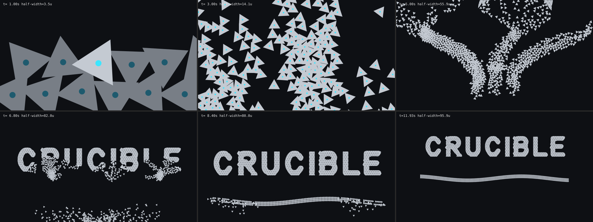

Beats at 1.0, 3.0, 5.0, 6.8, 8.4 and 11.9 s: one wedge wakes; the answer wave spreads and
units turn toward their lanes; three lanes; tiles fill far-first while the surplus leaves for
the ribbon; title complete; camera opens.

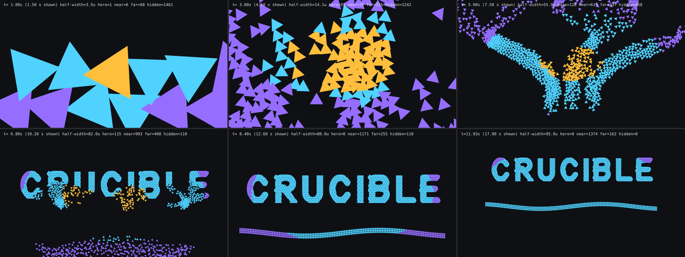

Same frames coloured by decision tier: amber hero, cyan near, violet far.

### Raise (S0c)

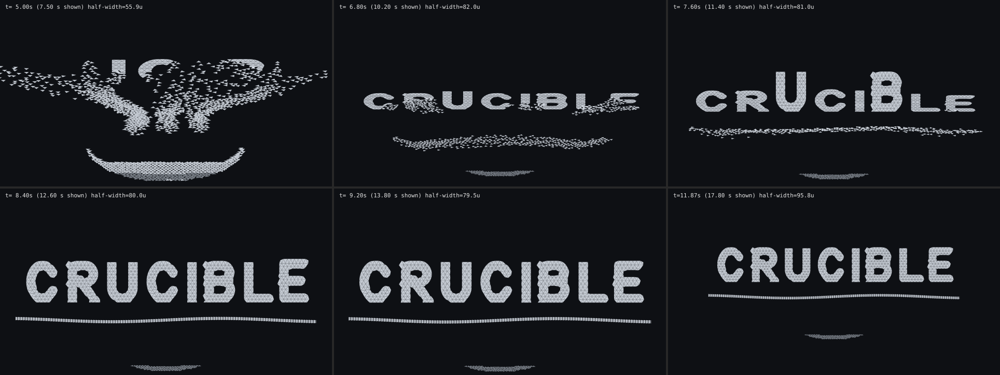

At 5.0, 6.8, 7.6, 8.4, 9.2 and 11.9 s through the oblique camera: letters assembling flat;
nearly complete; the first letters rising; most upright; all upright; camera opens.

### Hybrid (S0e)

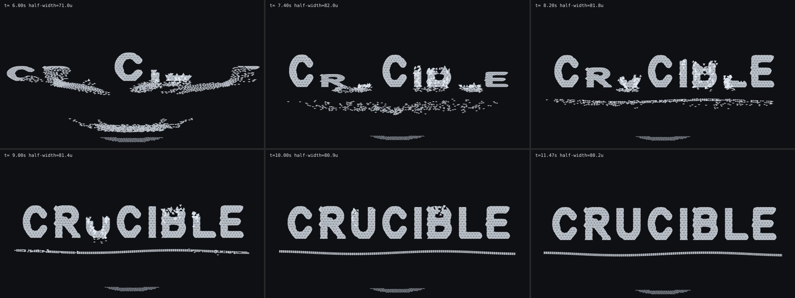

At 6.0, 7.4, 8.2, 9.0, 10.0 and 11.5 s: the first C has already swung up while the swarm
climbs the U, I, B and L; the R and second C rise; the E rises as the climbed letters grow;
the climbed letters finish; complete.

### Scaffold (S0f)

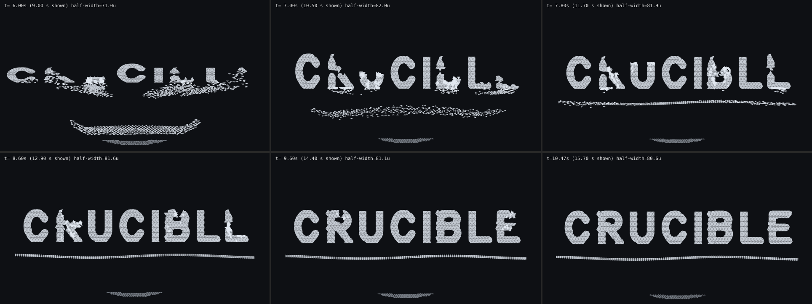

At 6.0, 7.0, 7.8, 8.6, 9.6 and 10.8 s: stems assembled flat; the first stems and the Cs swing
up; climbers gather at the bases; arms and bowls grow from the standing stems; complete.

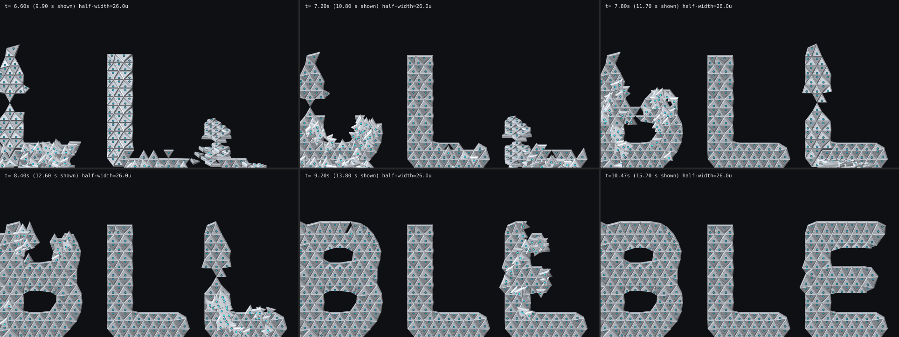

The B, L and E from 6.8 to 10.8 s: the L and E stems rise as drawbridges (foreshortened while
rising), then climbers pour over them to build the E's arms and the B's bowls.

### Morphing tiles

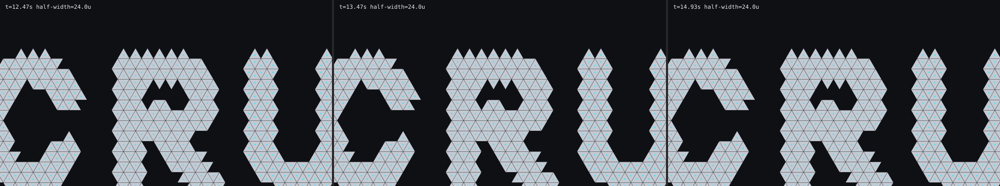

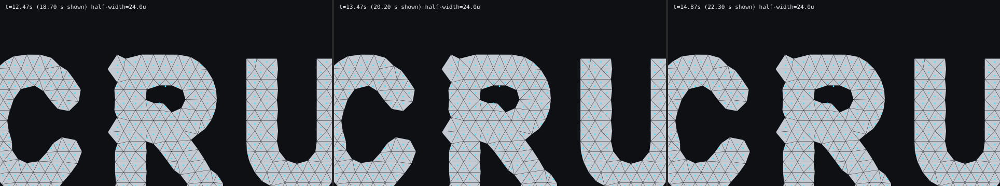

The C, R and U at 12.5, 13.5 and 14.9 s in the climb build, first with `--morph 0`, then
with the default morph. The bowls, counters and stroke ends follow the outline; joins stay
seamless.

### Climb (S0b, S0d)

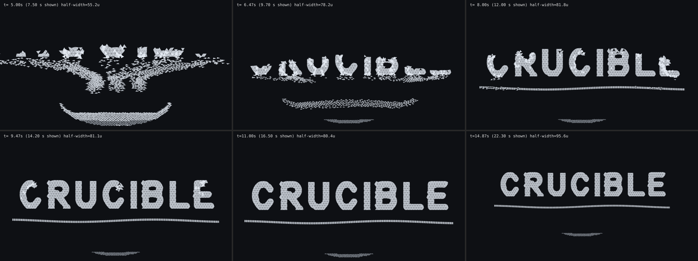

At 5.0, 6.5, 8.0, 9.5, 11.0 and 14.9 s: footings; letters growing bottom-up; climbers
pouring over the face; readable; nearly complete; complete at 11.4 s with the hold and camera
opening by 15 s.

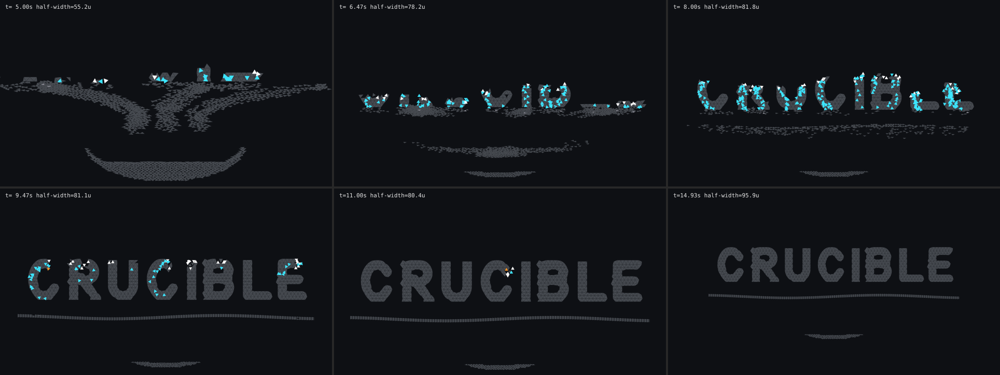

The same frames by magnet mode: cyan lift, white seat, amber push; grey units are off.

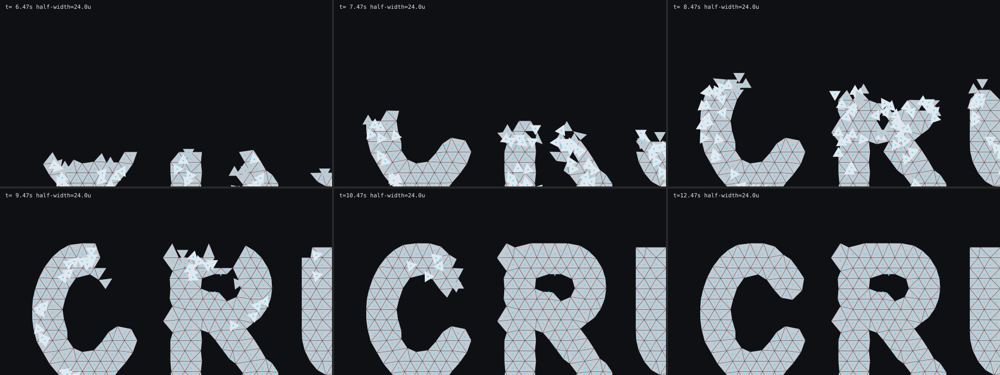

At 6.5–12.0 s: climbers (lighter) flowing over the solid tiles, the build front rising, and
the finished letters as single faces.

## Findings

1. **Full intelligence everywhere is slower, costlier and can freeze.** With reciprocal
   avoidance on every unit, an early uniform-hero run reached only 82% of the title by 10 s.
   Right of way by wake order fixed the freeze. Uniform hero is still 3.8 s slower than the
   camera-LOD run at about seven times its median cost, and needed 125 stuck recoveries.
2. **Lane throughput sets the lying timeline** (width × cruise speed).
3. **Decentralised slot swaps remove most crossings** (about 7,100 per lying run).
4. **The signal system dominates at 16K**, because every dormant unit polls its neighbours
   each tick. An event-driven wave front is the next optimisation.
5. **Lock sounds need aggregation:** up to 70 locks fall in one 100 ms window.
6. **Hidden units interpenetrate by design** and resolve before reaching the frame edge.
7. **With a preset order, honest climbing missed the brief by about 5 s** (13.5 s, rows).
8. **Climbing needs a vocabulary of rules**:
   - Which surface a unit is on follows its state, not its position.
   - Units stage on the ground before stepping onto the face.
   - Climbers flow over each other in layers.
   - Routes are shortest paths over the built face, with the ground linking strokes.
   - Seating is pipelined: slide in once the support is nearly seated, lock only on a
     locked support.
9. **Raise keeps the brief's timing and the upright ending** at no extra simulation cost.
10. **First-come claiming at the base beats a preset order.** Claims are just-in-time, each
    the lowest supportable tile nearest the unit, and the build finished at 11.8 s instead of
    13.5 s (1,104 equilateral tiles; 11.4 s with today's 1,066 morphed tiles and entry rules). Three changes made the difference, all found through the diagnostics log:
    - waypoints keep momentum;
    - climbers cling beside an unsupported slot;
    - seekers heaped at the wall's base flow over each other.

    No preset order means no planner coupling between wake order and build depth.
11. **Stuck intelligence resolves every episode in these runs.** Climb: 50 stuck episodes,
    37 pushes, no reclaims; all recovered (median 8 ticks, 90th percentile 32, longest 45). A
    whole-lane car-following rule was tried and rejected: lanes starting from rest jammed
    and the lying build slowed from 8 s to 15 s.
12. **Tessellation interlocks into a solid face.** It also makes the build shallower:
    vertex-sharing support gives 13–17 levels instead of 22. Equilateral tiles leave a
    stepped outline; morphing (finding 15) addresses it.
13. **The climb build's lane exits are crowded**: up to 9% visible ground contacts with
    1536 units, more at scale. That is a lane design issue (exits narrow as flow peaks), not
    a tuning one. Per-letter lanes or a wider landing zone are the follow-up.

14. **The whole-letter hybrid halves the crowding.** Raising the four deepest letters removes
    much of the climb's critical path and leaves fewer units converging on the wall:
    contacts fall from 9.1% to 4.3%. It finishes at 11.2 s against pure climbing's 11.4 s;
    when measured before the S0f entry rules, the gap was 10.9 s against 12.2 s. Per-part
    drawbridges (finding 16) go further.
15. **A little morph smooths a lot.** Moving outline corners by up to 0.35 of a side halves
    the outline error (−51%) with every tile keeping half its area. Larger limits help little
    (0.5 gives −50%, 0.7 gives −52%) because the area-quality pass holds them back. Fill and
    trim were needed first: without them the lone spikes at stroke ends cannot move far
    enough. Faint steps remain on some vertical stems, the clearest place for a later
    sub-tile edge piece.

16. **Per-part drawbridges make scaffolds.** Raising the tall grounded stems first, then
    climbing them, completes at 10.75 s. That is the fastest climbing build, with all eight
    panels upright by 8.6 s. Two rules made it work: raised tiles support climbers only once
    upright, at their standing positions (otherwise climbers steered to the flat tiles'
    ground coordinates and stalled); and arm tiles can be claimed while their stem is flat,
    so units wait at the base ready for the swing.
17. **Entry points matter as much as routes.** Stepping onto the wall over a gap between
    strokes left climbers hanging 2–2.7 units from anything built. Entering only beside a
    ground tile they can stand on brought scaffold off-surface time from 1.2% to 0.4%, and
    also sped up pure climbing (12.2 s to 11.4 s). The hybrid slowed from 10.3 s to 11.2 s
    under the same rule: its climbed letters now wait for real footholds.

## Limits

Orthographic top-down and oblique 2D stand-in cameras; no perspective, depth of field,
materials, bloom or real wedge mesh. One fixed seed. Glyphs are a prototype stroke font with
square caps, not the licensed wordmark asset. A unit snaps to its morphed shape when it
locks; a gradual morph while seating is a renderer detail for S1. The raise hinge is a rigid pose transform:
nothing yet shows what lifts the letter. Climbers and heaped seekers stack in layers; only
other ground movers are held apart.

Skip, reduced motion, resize and focus behaviour belong to the frontend package and are not
exercised. No GPU, audio or participant evidence.
